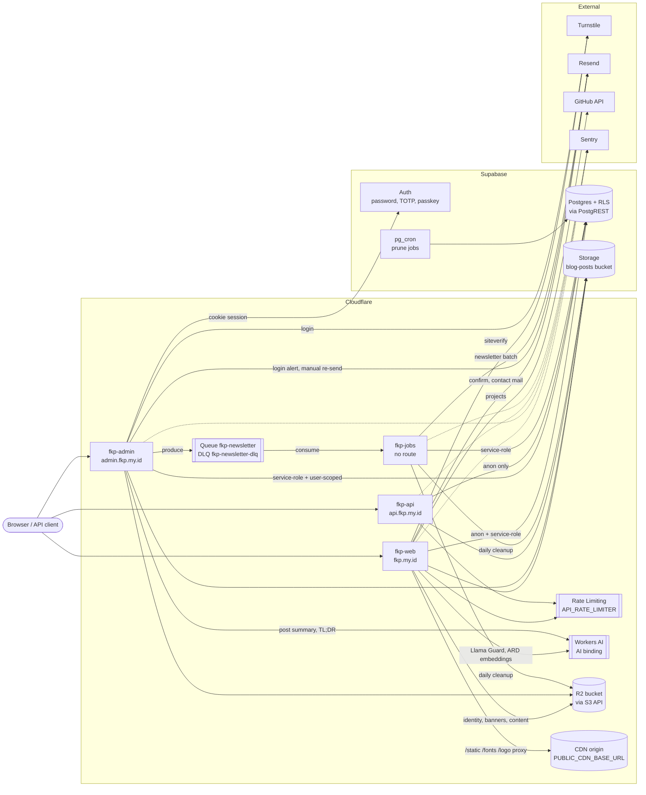

# 1. Component Map

The four Workers, what they talk to, and which direction each call goes.

## Notes

- **Workers** (`apps/*/wrangler.jsonc`):
    - `fkp-web` serves `fkp.my.id` and `www.fkp.my.id`, which is redirected to the apex.
    - `fkp-admin` serves `admin.fkp.my.id`.
    - `fkp-api` serves `api.fkp.my.id`.
    - `fkp-jobs` sets `workers_dev: false` and has no route. Its `fetch` handler returns 404.
- **R2 is not a Worker binding.** Every R2 read and write goes through the S3-compatible API (`@aws-sdk/client-s3`) using the `R2_*` secrets. No `r2_buckets` entry exists in any `wrangler.jsonc`.
- **`API_RATE_LIMITER` is the Workers Rate Limiting binding** (`ratelimits`, 60 requests per 60 s). It is namespace `1001` on web and `1002` on api. When the binding is missing, `packages/lib/src/server/rateLimit.ts` falls back to an in-memory window.
- **Queue:** admin publishes to `fkp-newsletter` through the `NEWSLETTER_QUEUE` producer. Jobs consumes it with batch size 10, 5 retries, and DLQ `fkp-newsletter-dlq`, and also consumes the DLQ to report each dead-lettered message to Sentry.
- **Cron:**
    - Jobs runs `17 3 * * *` (UTC) for asset cleanup.
    - Supabase `pg_cron` runs `prune-stale-subscriptions` (`17 3 * * *`), `prune-activity-log` (`31 3 * * *`) and `prune-login-failures` (`37 * * * *`).
- **Sentry** is reached through the SDKs: `@sentry/sveltekit` on web and admin, `@sentry/cloudflare` on api and jobs.

## Source

- `apps/web/wrangler.jsonc`, `apps/admin/wrangler.jsonc`, `apps/api/wrangler.jsonc`, `apps/jobs/wrangler.jsonc`
- `packages/lib/src/server/profileAssets.ts` (`assetStorage`), `rateLimit.ts`, `newsletterQueue.ts`
- `apps/jobs/src/index.ts`
- `cron.job` in the Supabase project
