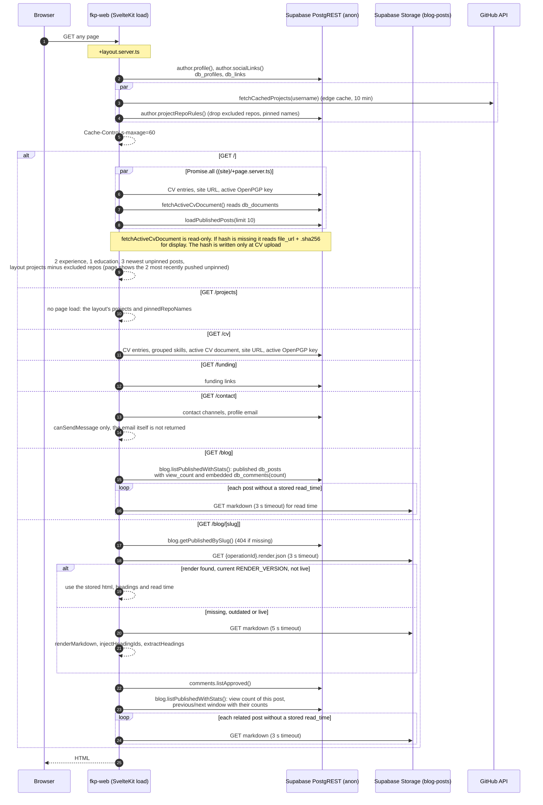

# 3. Page Render (`/`, `/projects`, `/cv`, `/funding`, `/contact`, `/blog`, `/blog/[slug]`)

How the public pages load their data. Every page load uses the **anon** Supabase client from `packages/lib/src/supabase.ts`. No session is involved, and RLS limits reads to public rows. Posts, comments and author data are read through the `@idstead/data` repositories from `publicRepositories(fetch)`, so page data carries no database IDs.

## Notes

- **Client navigation:** links preload code and data on hover, Spotlight preloads its highlighted command, and the `(site)` layout preloads every section's code when idle. No page load calls `parent()`, so navigating between section pages runs only that page's load, and `pageDataCache` (`packages/lib/src/server/pageDataCache.ts`) serves the six section pages' `__data.json` from the edge cache for 60 s.

- **Post data:**
    - Posts expose `public_id` as `id`. The UUID never leaves the server: the repositories return `@idstead/domain/blog.ts` DTOs and keep the post's storage location in an opaque `PostSource`.
    - Comment and view counts come from embedded counts in the listing query, so a list costs one query plus a markdown fetch per post until posts store `read_time`.
    - The banner URL is built by `publicBannerUrl()` (`packages/lib/src/blogBanner.ts`) as `{PUBLIC_CDN_BASE_URL}/blog/{slug}/banner.webp`, with `banner.avif` as the preferred source (see [008-asset-pipeline.md](008-asset-pipeline.md#blog-post-assets)).
- **Markdown** lives in Supabase Storage (`blog-posts`). Images and banners live in R2 (see [008-asset-pipeline.md](008-asset-pipeline.md)).
- **Pre-rendered posts:** each saved post has a `.render.json` next to its markdown (see [007-publish-post.md](007-publish-post.md#notes)). The post page serves it without running the MDRS engine. It renders on the request only when the file is missing or was written by another `RENDER_VERSION`. Posts flagged `live` (they read `api.*` data) are served from the stored file as well, so their live data can be up to a day old: the jobs worker re-renders them after every publish and in its daily cron (see [007-publish-post.md](007-publish-post.md#notes)). Only the service role can write to the bucket, so the stored HTML is trusted as sanitized at save time.
- **Service-role data:** `/subscribe/confirm` and `/unsubscribe` use `serviceData(platform).writers.subscribers` (`SubscriberRepository` from `@idstead/data`).

## Source

- `apps/web/src/routes/+layout.server.ts`
- `apps/web/src/routes/(site)/+page.server.ts`, `(site)/{projects,cv,funding,contact,blog}/+page.server.ts`
- `apps/web/src/routes/blog/[slug]/+page.server.ts`
- `packages/data/src/author.ts`, `supabase/author.ts`, `packages/domain/src/author.ts`
- `packages/lib/src/server/blogPosts.ts`, `repositories.ts`, `githubProjects.ts`, `postRender.ts`
- `packages/data/src/blog.ts`, `supabase/blog.ts`
