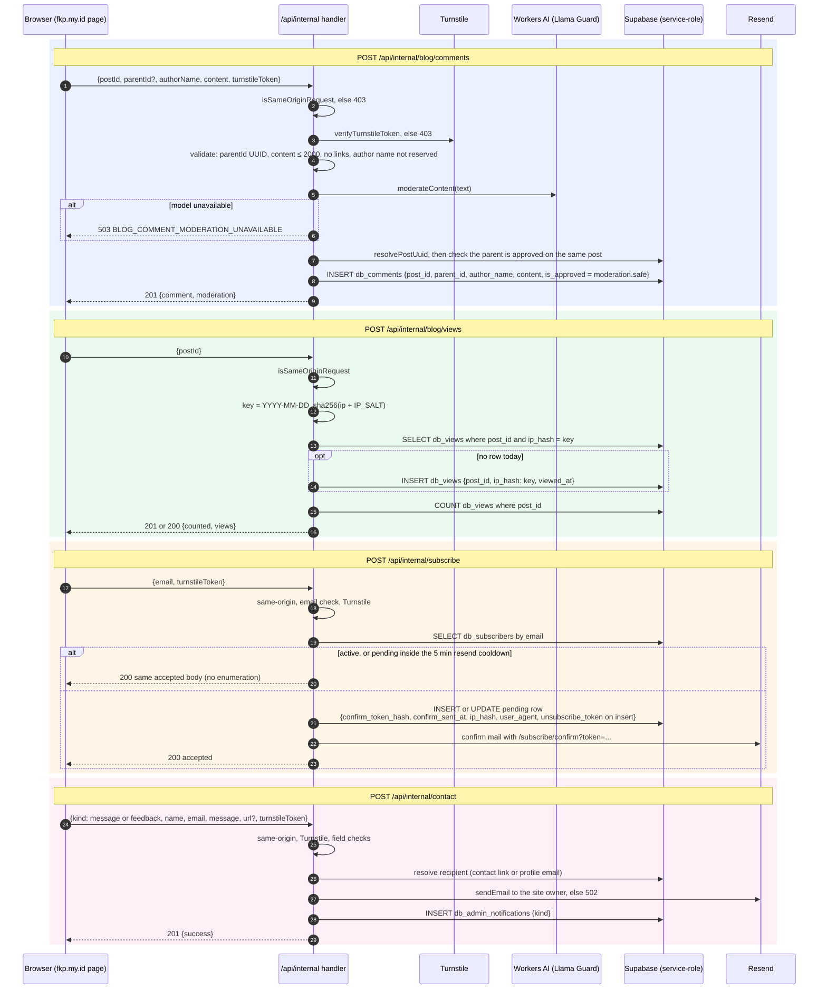

# 4. Public Write Endpoints (`/api/internal/**` on fkp-web)

These endpoints are unversioned and first-party only. They are called by the site's own pages and are not part of the public API. Before a handler runs, the hook has already applied its `/api/*` behaviour: OPTIONS preflight, rate limiting, `no-store`, `noindex`, and the error envelope.

## All web internal endpoints

| Endpoint | Guards | Writes |
| --- | --- | --- |
| `POST /api/internal/blog/comments` | same-origin, Turnstile, validation, Llama Guard | `db_comments` |
| `POST /api/internal/blog/comments/report` | same-origin, Turnstile, reason allow-list | `db_comment_reports` |
| `POST /api/internal/blog/views` | same-origin | `db_views` |
| `POST /api/internal/feedback` | same-origin, `sec-fetch-site` not `cross-site` | RPC `db_record_page_feedback`, which writes `db_feedback_operations`, `db_feedback_events` and, for posts, `db_post_feedback` and `db_posts.helpful_*` |
| `POST /api/internal/subscribe` | same-origin, Turnstile | `db_subscribers` and a confirm mail |
| `POST /api/internal/subscribe/unsubscribe-request` | same-origin, Turnstile | none (mails an unsubscribe link without revealing whether the address exists) |
| `POST /api/internal/subscribe/unsubscribe` | 64-hex token | `db_subscribers.status = 'unsubscribed'` (always 204) |
| `POST /api/internal/contact` | same-origin, Turnstile | a mail to the owner, then `db_admin_notifications` |

## Notes

- **Clients:** writes use `getSupabaseAdminClient()` (service role, bypasses RLS). It is server-only (`packages/lib/src/server/supabaseAdmin.ts`).
- **Activity log:** these public endpoints do **not** write `db_activity_log`. Only admin endpoints do.
- **IP hashing** uses SHA-256 of the IP plus `IP_SALT`. It is used for view de-duplication, report and feedback tracking, and subscriber rows.

## Source

- `apps/web/src/routes/api/internal/**/+server.ts`
- `packages/lib/src/server/sameOrigin.ts`, `turnstile.ts`, `moderation.ts`, `pageFeedback.ts`, `subscribers.ts`, `unsubscribeRequest.ts`
- `supabase/migrations/20260911123339_feedback_operation_replay.sql` (`db_record_page_feedback`)
