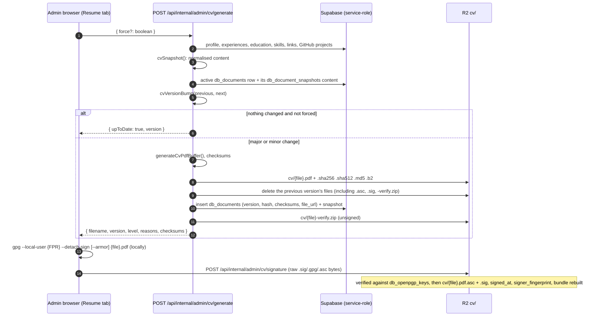

# 11. CV Documents

The admin generates the CV PDF on fkp-admin (`POST /api/internal/admin/cv/generate`). The server picks the version number itself, stores the PDF with its checksums and a verification bundle in R2 under `cv/`, and the admin attaches a detached OpenPGP signature that the server verifies against the published public key.



## Versioning

File name: `CV-{Name}-{sha256[0..7]}-v{major}.{minor}.pdf`. The first CV is `v1.0`. There is no patch number. Older names such as `-v1.0.13.pdf` are read as `1.0`.

The bump is decided by `cvVersionBump()` (`packages/lib/src/cvVersion.ts`), which compares the new content snapshot with the snapshot of the active version.

**Major** (`v1.3` → `v2.0`): who you are or what you have done.

| Change | Example |
| --- | --- |
| Name or job title | `Software Engineer` → `Senior Software Engineer` |
| Work experience added or removed | a new job |
| Company, role, employment type or dates of an experience | the "currently here" job ends |
| Education added or removed, or its institution, degree, field or dates | a master's degree is added |

**Minor** (`v1.3` → `v1.4`): refinements.

| Change | Example |
| --- | --- |
| Descriptions of experience or education, bio, grade | rewording a bullet point |
| Skills | adding Go, reordering categories |
| Projects | a GitHub repository is pinned, excluded, or its stars change the order |
| Contact details and links | email, website, location, GitHub or LinkedIn |
| Profile photo | a new avatar |
| PDF template | `CV_TEMPLATE_VERSION` is raised |

- When both kinds of change are present, the bump is major. The response lists every reason, e.g. `Experience added, Bio changed`.
- When nothing changed, no new file is made and the admin shows "The CV is already up to date". **Regenerate** forces a new build, which counts as minor (useful after a font change).
- A CV without a stored snapshot (made before this scheme) gets a minor bump on its next generation.
- Saving the profile or the resume entries in the admin calls generate without `force`, so unchanged content never creates a version.

## Files in `cv/`

| File | Content |
| --- | --- |
| `{file}.pdf` | the CV |
| `{file}.pdf.sha256`, `.sha512`, `.md5`, `.b2` | coreutils format: `{hex}  {file}.pdf` (BLAKE2b-512 for `.b2`) |
| `{file}.pdf.asc` | ASCII-armored detached OpenPGP signature (when signed) |
| `{file}.pdf.sig` | the same signature in binary form (when signed) |
| `{file}-verify.zip` | the PDF, its checksum files, `.asc` and `.sig` when signed, `publickey.asc`, and a generated `VERIFY.txt` |

The public API serves each of these as an attachment: `GET /v1/cv?output=pdf|sha256|sha512|md5|b2|asc|sig|zip` (see the API README). The homepage "Download CV" button opens a menu with "Download PDF", "Download all" (the zip), and "Verify integrity", a dialog that shows the signer, the fingerprint, the key sources and the commands.

Verify a download:

```sh
sha256sum -c CV-Name-1234567-v1.0.pdf.sha256
b2sum -c CV-Name-1234567-v1.0.pdf.b2
gpg --locate-keys you@example.com
gpg --verify CV-Name-1234567-v1.0.pdf.sig
```

## Signing key

A detached signature carries only the issuer's key ID. The signer's name and email and the place to fetch the key come from the published public key:

- The admin uploads the public key (armored or binary) in the **OpenPGP key** card. `POST /api/internal/admin/openpgp-key` parses it with OpenPGP.js (`server/openpgp.ts`). It rejects private, revoked or expired keys and keys without a signing key or a valid user ID, and stores the fingerprint, user IDs, algorithm and expiry it reads from the key. Name and email are never typed by hand, so they cannot drift from the signature.
- One key is active (`db_openpgp_keys`, public read for the active row). Replacing it with a different fingerprint removes the current CV signature; `DELETE` removes the key and the signature.
- The key is published at `/pgp.asc` and through WKD (direct method): `/.well-known/openpgpkey/hu/{zbase32(sha1(local-part))}` serves the binary key for every user ID whose email is on the site's domain, and `/.well-known/openpgpkey/policy` is empty. `gpg --locate-keys` therefore finds it without a keyserver.
- Keyserver links (keys.openpgp.org, keyserver.ubuntu.com, or a custom https URL) are optional. Each is fetched on save and must return the same fingerprint (`verifyKeyserver()`).
- `publickey.asc` in the bundle is a convenience copy. `VERIFY.txt` tells readers to compare its fingerprint with the website or a keyserver.

## Signature

- The private key never reaches the server. Sign the exact PDF locally with `gpg --local-user {FPR} --detach-sign {file}.pdf` (add `--armor` for `.asc`) and upload the file in the CV Document card.
- `POST /api/internal/admin/cv/signature` takes the raw file (at most 16 KiB): an armored `PGP SIGNATURE` block or a binary detached signature (`.sig`/`.gpg`). A full `gpg --sign` message is rejected. The server checks that the signature comes from the active key and verifies it against the stored PDF before publishing it as both `.asc` and `.sig`. A mismatch returns 422 and names the problem (another file, or another key). `DELETE` removes both files. Both are admin-only and same-origin.
- A new CV version deletes the old signature, because a signature covers one file. The card shows "Unsigned" until the new PDF is signed.

## Data

- `db_documents` (public read): `filename`, `file_url`, `hash` (SHA-256), `checksums` (`sha256`, `sha512`, `md5`, `b2`), `version`, `signed_at`, `signer_fingerprint`, `is_active`.
- `db_openpgp_keys` (public read of the active row; writes through the service role): `fingerprint`, `armored`, `user_ids`, `algorithm`, `key_created_at`, `expires_at`, `keyservers`, `is_active`.
- `db_document_snapshots` (service role only): the content snapshot per document. It holds contact details, so it is not on the public table.

## Source

- `packages/lib/src/server/adminCv.ts` (`processCvGenerate`, `processCvSignature`, `processOpenPgpKey`, `deleteCvFile`)
- `packages/lib/src/server/openpgp.ts`, `packages/lib/src/openpgpKey.ts`, `packages/lib/src/cvVerification.ts`, `packages/lib/src/server/cvBundle.ts`
- `packages/lib/src/cvVersion.ts`, `packages/lib/src/server/cvChecksums.ts`
- `packages/lib/src/server/api/author.ts` (`/v1/cv` file outputs and `cv.document`)
- `apps/admin/src/routes/api/internal/admin/{cv/{generate,signature,delete},openpgp-key}/+server.ts`
- `apps/admin/src/routes/(admin)/+page.svelte` (CV Document and OpenPGP key cards)
- `apps/web/src/routes/pgp.asc/+server.ts`, `apps/web/src/routes/.well-known/openpgpkey/**`
- `apps/web/src/lib/components/CvDownloadMenu.svelte`
- `supabase/migrations/20261016120000_cv_versions.sql`, `supabase/migrations/20261017090000_cv_openpgp.sql`
