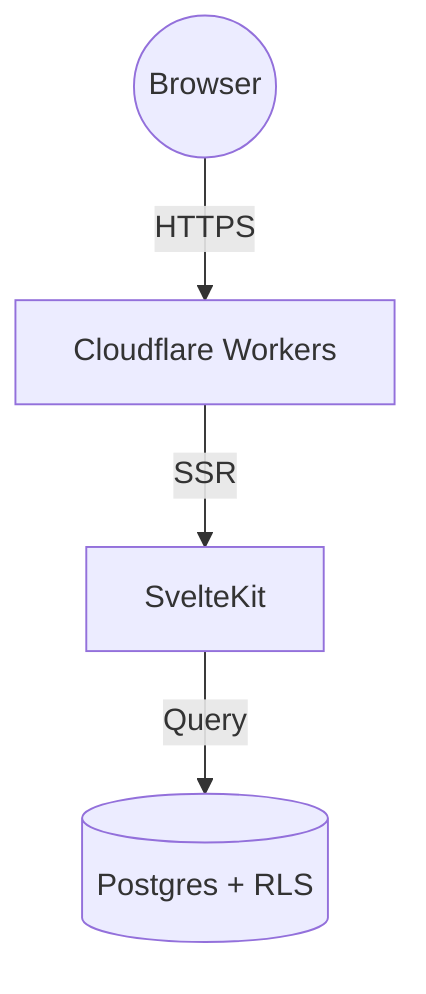

# Diagrams and charts

Two fenced code languages are rendered as graphics instead of code. The server emits a placeholder that holds the encoded source, and the browser draws the graphic (`enhanceMarkdownContent`).

## Mermaid diagrams

````mdrs

````

```html
<div class="mdrs-mermaid">
    <div class="mdrs-mermaid-display">
        <div class="mdrs-mermaid-loading">…<span>Rendering diagram…</span></div>
    </div>
    <div
        class="mdrs-mermaid-source"
        hidden
        data-mdrs-source="graph%20TD%0A…"></div>
</div>
```

- Any [Mermaid](https://mermaid.js.org) diagram type works: flowcharts, sequence, git graphs, class, state, Gantt, and so on.
- The Mermaid library is loaded only when a page has a diagram.
- Mermaid runs with `securityLevel: 'strict'`, so diagram labels can't run scripts or embed HTML.
- Colours follow the site theme and are redrawn when the theme switches between light and dark.

## Charts

A ` ```chart ` block (or its alias ` ```layerchart `) holds a chart spec in YAML or JSON. The browser renders it as an interactive SVG chart with [LayerChart](https://layerchart.com).

````mdrs
```chart
type: line
title: Monthly active developers
subtitle: 2026
x: month
y: users
data:
  - { month: "Jan", users: 1200 }
  - { month: "Feb", users: 1950 }
  - { month: "Mar", users: 3100 }
```
````

### Spec fields

| Field | Type | Default | Meaning |
| --- | --- | --- | --- |
| `type` | `line`, `bar`, `area`, `donut`, `pie` | `line` | Chart type |
| `title` | string | none | Heading above the chart |
| `subtitle` | string | none | Smaller text under the title |
| `x` | string | the first key of the first data row | Field for the x axis, or the category in donut and pie charts |
| `y` | string or list of strings | the second key of the first data row | Field(s) for the values; a list draws one series per field |
| `series` | list of `{ key, label?, color? }` | derived from `y` | Series with custom labels and colours |
| `data` | list of objects | none | The rows |
| `height` | number (px) | `300` | Chart height |

A spec that starts with `{` is parsed as JSON, anything else as YAML.

### Several series

````mdrs
```chart
type: line
title: Cold-start build time
subtitle: ms, lower is better
x: version
y: ["svelte", "react", "vue"]
series:
  - { key: "svelte", label: "SvelteKit", color: "#ff3e00" }
  - { key: "react", label: "Next.js", color: "#61dafb" }
  - { key: "vue", label: "Nuxt", color: "#42b883" }
data:
  - { version: "v1", svelte: 450, react: 1200, vue: 900 }
  - { version: "v2", svelte: 310, react: 820, vue: 650 }
```
````

Without `color`, series take colours from the site palette in order.

### Donut and pie

````mdrs
```chart
type: donut
title: Traffic by channel
x: channel
y: visitors
data:
  - { channel: "Search", visitors: 4500 }
  - { channel: "GitHub", visitors: 3200 }
  - { channel: "Direct", visitors: 1800 }
```
````

### Errors and empty charts

- A spec that is not valid YAML or JSON renders a red box: `Invalid chart specification: <parser message>`.
- An empty spec, or one that isn't an object, renders `Chart data is empty or malformed.`
- A spec without data rows renders `No chart data provided`.

Every chart has an options menu with **Copy spec JSON**.

Source: `packages/lib/src/markdown.ts` (`code` renderer), `packages/lib/src/utils/mermaid.ts`, `packages/lib/src/utils/markdownCharts.ts`, `packages/lib/src/components/markdown/MarkdownChart.svelte`.
