# Rendering pipeline

MDRS renders in two phases: a server pass that turns the source into sanitized HTML, and a browser pass that adds interactivity. Knowing the order explains most of the rules on the other pages, for example why code protects directives and why `${…}` works inside math.

## Server pass

```mermaid
flowchart TD
    A[Source] --> A1["Strip U+E000/U+E001,<br/>remove YAML frontmatter<br/>(frontmatter.ts)"]
    A1 --> B["Extract :::define block<br/>(define.ts)"]
    B --> C["Evaluate define entries<br/>(only if the block has entries)"]
    C --> D["Extract :::ignore-render blocks<br/>as escaped pre"]
    D --> E["Protect ${…} and [text].${…}<br/>(only with :::define; code and \${ skipped)"]
    E --> F["Extract math<br/>$$ … $$ and :::math"]
    F --> G[Resolve interpolation]
    G --> H["Render math with KaTeX<br/>(interpolation inside formulas resolved first)"]
    H --> I["Extract :::references<br/>(markdownReferences.ts)"]
    I --> J["Load icons named in icon=…<br/>(markdownIcons.ts)"]
    J --> J1["Turn GitHub alerts<br/>> [!NOTE] into :::note"]
    J1 --> K["Parse directives<br/>:::name … ::: and ::tab … ::"]
    K --> L["marked: CommonMark + GFM + footnotes,<br/>custom code, table, list, link, image renderers"]
    L --> M[Style details blocks]
    M --> N[Build steps]
    N --> O[Format footnote back-links, place References]
    O --> P[Restore math and ignore-render placeholders]
    P --> Q["sanitizeHtml allowlist"]
    Q --> R["injectHeadingIds (mdrs- IDs), prefixHashLinks,<br/>extractHeadings (prepareMarkdownPage)"]
```

`renderMarkdownUnsafe` runs every step up to restoring placeholders, `renderMarkdown` adds `sanitizeHtml`, and `prepareMarkdownPage` adds heading IDs, rewrites same-document links to them, and builds the table of contents.

Internal placeholders are wrapped in the private-use characters U+E000 and U+E001 (`placeholders.ts`). Those characters are removed from the source first, so no input can forge or collide with a placeholder.

Code spans and fenced code blocks are swapped for placeholders before the define, math and directive passes run, and restored afterwards. That's why MDRS syntax inside code stays literal.

## Browser pass

`enhanceMarkdownContent({ container, isDark, onCodeCopy })` runs after the HTML is in the page:

1. `enhanceCodeBlocks`: header bar, copy, download, options menu, line numbers, `mark=` highlighting, wrap, clean mode.
2. `enhanceMarkdownTabs`: tab switching, `key` sync, snippet controls, number-key shortcuts.
3. `enhanceMarkdownDetails`: the <kbd>E</kbd> shortcut on details.
4. `enhanceMarkdownCharts`: parses chart specs and mounts `MarkdownChart.svelte`.
5. `enhanceMermaidBlocks`: loads Mermaid and draws the diagrams.

Pages also call `hljs.highlightElement` on code blocks before enhancing them, and `enhanceHeadingAnchors` for the ¶ links.

## Public functions

| Function | Module | Purpose |
| --- | --- | --- |
| `renderMarkdown(markdown, supabase?)` | `markdown.ts` | Full server render, sanitized |
| `renderMarkdownUnsafe(markdown, supabase?)` | `markdown.ts` | The same without `sanitizeHtml`; only for trusted post-processing |
| `prepareMarkdownPage(markdown, supabase?)` | `markdown.ts` | `renderMarkdown` + `injectHeadingIds` + `prefixHashLinks` + `extractHeadings`, returns `{ html, headings }` |
| `injectHeadingIds(html)`, `prefixHashLinks(html)`, `extractHeadings(html)` | `markdown.ts` | Heading IDs, same-document links and table of contents |
| `convertGithubAlerts(markdown)` | `markdown.ts` | `> [!NOTE]` → `:::note` |
| `extractFrontmatter(markdown)`, `importPostDocument(text)` | `frontmatter.ts` | YAML frontmatter and the admin file import |
| `parseAttrs`, `escapeAttr`, `escapeUrl`, `sanitizeUrl` | `markdown.ts` | Attribute and URL helpers |
| `sanitizeHtml(html)` | `sanitizeHtml.ts` | The allowlist sanitizer |
| `extractDefineBlock`, `hasDefineEntries`, `evaluateDefineBlock`, `validateDefineForSave`, `createApiRegistry` | `define.ts` | Variables, live data and save validation |
| `validateMdrsRemote(markdown)`, `mdrsContent(label)` | `mdrsValidation.ts` | Editor-side validation through `POST /api/internal/blog/validate-define` |
| `resolveMdrsHash(hash, container)` | `utils/headingAnchors.ts` | Maps `#setup` to `#mdrs-setup` when the page scrolls to a hash |
| `markdownToPlainText(markdown)` | `utils/markdownToText.ts` | Plain-text version for `.txt` routes and `?output=txt` |
| `enhanceMarkdownContent(options)` | `utils/markdownEnhancer.ts` | Browser pass |
| `enhanceHeadingAnchors(container)` | `utils/headingAnchors.ts` | ¶ anchor links |

Pass a Supabase client to enable [live data](../002-extensions/014-live-data.md); without one, `api.v1.*` renders an error marker.

## Where MDRS is used

| Place | Call |
| --- | --- |
| Blog post page (`apps/web/src/routes/blog/[slug]`) | `renderMarkdown` + `injectHeadingIds` + `prefixHashLinks` + `extractHeadings` |
| Legal pages (`/privacy`, `/terms`, `/security`) | `prepareMarkdownPage` |
| Admin editor preview (`MarkdownEditor.svelte`) | `renderMarkdown` in the browser, `injectHeadingIds`, `prefixHashLinks` |
| Admin editors (post, privacy, security, terms) while typing and before saving | `validateMdrsRemote` → `validateDefineForSave` |
| Admin post save | `validateDefineForSave` |
| `.md` and `.txt` variants, `GET /v1/blog/content` | The raw source, or `markdownToPlainText` for text output |

## Limits

| Limit | Value | Behaviour |
| --- | --- | --- |
| Document size | 500,000 characters | `renderMarkdown` throws `Markdown document is too large to render.` |
| Directive nesting | 16 levels | Deeper opening lines are plain text |
| Placeholder expansion | 5,000 per document | Further placeholders are left unexpanded |
| `api.v1.blog` list | 20 newest published posts |  |
| Conditional text nesting | 8 levels | Deeper `${…}` inside `[…].${…}` is left as written |
| Frontmatter nesting | 16 levels | Deeper YAML is a parse error |

## Migrating legacy syntax

Before MDRS settled on `:::name key="value"`, posts used older forms: GitHub `> [!NOTE]` alerts (which now render directly as well), `:::callout{title="…"}` and `::tab{…}` braces, `::::` wide closers, raw `
` and `<video>` HTML, `\[ … \]`, `\( … \)` and single-`$` math, and `{1,3-5}` fence line markers. `scripts/migrate-markdown-syntax.ts` (built on `packages/lib/src/legacyMarkdown.ts`) converts stored posts to the current syntax. It runs as a dry run by default; see [Scripts and tooling](../../004-development/004-scripts-and-tooling.md).

Source: `packages/lib/src/markdown.ts` (`renderMarkdownUnsafe`, `renderMarkdown`, `prepareMarkdownPage`), `packages/lib/src/frontmatter.ts`, `packages/lib/src/placeholders.ts`, `packages/lib/src/utils/markdownEnhancer.ts`, `packages/lib/src/legacyMarkdown.ts`.
