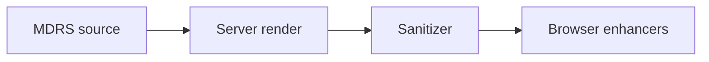

:::define
site: "my-site.example"
author: api.v1.author.profile.name
posts: api.v1.blog.length
version: "1.0"
year: 2026
stable: true
features: ["callouts", "tabs", "steps", "math", "charts"]
engine: { language: "MDRS", extension: ".mdrs", directives: 14 }
greeting: "Welcome to " + this.site
:::

**${greeting}.** This post is written in MDRS ${version}, the Markdown dialect that powers every article here. It is plain Markdown first. Everything after that is an extension, and each one appears at least once below, so the source of this post doubles as a reference.

:::note
Every section starts with the syntax you already know from CommonMark and GitHub Flavored Markdown, then adds what MDRS brings on top. Jump straight to [the extensions](#callouts-and-alerts) if you know Markdown well.
:::

## Writing text

A paragraph is just lines of text. A single line break inside it
becomes a space, and a backslash at the end of a line\
forces a hard break.

You get **bold**, *italic*, ***both***, ~~strikethrough~~ and `inline code`. Inline HTML covers the rest: press <kbd>Ctrl</kbd> + <kbd>K</kbd>, write H<sub>2</sub>O and E = mc<sup>2</sup>, <mark>highlight a phrase</mark>, <u>underline</u> one, or expand an <abbr title="Markdown Rich Syntax">MDRS</abbr> abbreviation. <small>Small print is fine too</small>, as are <q>short quotations</q>, <cite>titles of works</cite> and dates like <time datetime="2026-10-17">17 October 2026</time>.

Escape any punctuation with a backslash: \*not italic\*, \# not a heading, and \$$ not math. Entities work as well: &copy; &mdash; &rarr;.

### Links and images

Links can be [inline](https://commonmark.org "CommonMark"), [by reference][gfm], or bare: https://github.github.com/gfm/ and www.example.com both become links, as does an address like hello@example.com. Links to other sites open in a new tab and get a small arrow; [links within this site](/blog) don't.

[gfm]: https://github.github.com/gfm/ "GitHub Flavored Markdown"


### Definitions

<dl>
<dt>MDRS</dt>
<dd>Markdown Rich Syntax, a drop-in superset of CommonMark and GFM.</dd>
<dt>.mdrs</dt>
<dd>The file extension for documents that use it.</dd>
</dl>

## Lists

Bullets and numbers work as you'd expect, and lists nest:

- Server
  - KaTeX math
  - Variables and live data
- Browser
  - Mermaid diagrams
  - Charts

3. Numbered lists can start anywhere,
4. and the numbers after the first one don't matter.
4. This is still item five.

A loose list, with blank lines between items, keeps its paragraphs apart:

- The first item has room to breathe.

- So does the second one.

### Task states

GFM gives you `[ ]` and `[x]`. MDRS adds five more states:

- [x] Write the engine
- [*] Write the docs
- [/] Port the parser to Rust
- [-] Support single-dollar math
- [!] Keep it a drop-in superset
- [?] Ship a VS Code extension?
- [ ] Publish the first release
  - [x] Reserve the package names
  - [ ] Write the changelog

They work in numbered lists too:

1. [x] Reserve `@mdrs/core`
2. [*] Extract the engine
3. [ ] Tag `v0.1.0`

## Quotes and tables

> A blockquote is a `>` at the start of a line.
>
> > Quotes nest, and hold any Markdown:
> >
> > - even lists

| Feature | Where it runs | Status |
| :--- | :---: | ---: |
| Directives | Server | Stable |
| Math | Server | Stable |
| Diagrams | Browser | Stable |
| Charts | Browser | Beta |

## Code

Fences take a language, an optional `filename` and an optional `mark` to highlight lines:

```ts filename="greet.ts" mark=2,4..5
export function greet(name: string) {
    const message = `Hello, ${name}!`;
    console.log(message);
    return message.length;
}
```

Diffs are coloured line by line:

```diff
- const engine = 'markdown';
+ const engine = 'mdrs';
```

A shell fence without script constructs becomes a command block, with a prompt instead of line numbers:

```sh
bun add @mdrs/core
```

Indented code works too:

    plain indented code
    keeps its spacing

## Callouts and alerts

:::note
Background the reader can safely skip.
:::

:::tip
A shortcut that saves time.
:::

:::important
A step that must not be skipped.
:::

:::warning
A breaking change or a surprise.
:::

:::caution
Something that can lose data.
:::

GitHub's alert syntax renders the same callouts, so READMEs look right here:

> [!TIP]
> This one was written as `> [!TIP]`.

Custom callouts take a title and an optional Lucide or Bootstrap icon:

:::callout title="Changelog" icon="rocket"
**v${version}**: frontmatter, GitHub alerts, numbered task states and `mdrs-*` classes.
:::

:::callout title="Made with Bootstrap Icons" icon="bi-github"
Prefix the name with `bi-` or `lucide-` to pick the library.
:::

## Details

:::details summary="What makes MDRS a drop-in superset?"
Plain Markdown renders exactly as on any CommonMark or GFM renderer. MDRS only adds meaning where plain Markdown has none, or where a document opts in, as this one does with its `:::define` block.

:::details summary="Details nest"
And they can hold any Markdown.
:::
:::

<details>
<summary>Raw HTML details get the same styling</summary>

Leave blank lines around Markdown inside them.

</details>

## Tabs and snippets

:::tabs
::tab label="Server" icon="server"
Directives, math, variables and live data are resolved on the server, so readers get finished HTML.
::
::tab label="Browser" icon="monitor"
Highlighting, diagrams, charts and the code block controls run in the browser.
::
:::

Snippet groups add copy and download controls. Groups with the same `key` stay in sync, so picking "npm" below switches both:

:::snippets key="pm"
::tab label="bun" icon="terminal"
```sh
bun add @mdrs/core
```
::
::tab label="npm" icon="package"
```sh
npm install @mdrs/core
```
::
:::

:::snippets key="pm"
::tab label="bun"
```sh
bun run dev
```
::
::tab label="npm"
```sh
npm run dev
```
::
:::

## Steps

:::steps
1. Write the post in MDRS.
2. Import the file in the admin.
3. Publish.
:::

:::steps
### Draft

Start from the frontmatter: title, excerpt and tags.

### Review

The editor checks every expression while you type.

### Ship

Readers get static HTML, rendered on the server.
:::

## Media

:::embed url="https://www.youtube.com/watch?v=VyPwEZTIpVc"

A link ending in `.mp4` or `.webm`, written as an image (``), becomes a `<video>` player.

## Math

Inline formulas sit in the text, like Euler's identity $$ e^{i\pi} + 1 = 0 $$ or $$x^2$$. Prices stay prices, though: a single `$` never starts math, so a coffee is $5 and a book is $10.

:::math
\int_{-\infty}^{\infty} e^{-x^2} \, dx = \sqrt{\pi}
:::

Formulas can use variables. There are ${features.length} headline features:

$$ n = ${features.length}, \quad \binom{n}{2} = ${features.length * (features.length - 1) / 2} $$

## Diagrams and charts



```chart
type: bar
title: Directives by kind
x: kind
y: count
data:
  - { kind: "Callouts", count: 6 }
  - { kind: "Layout", count: 5 }
  - { kind: "Content", count: 3 }
```

## Variables and live data

This post's `:::define` block mixes literals, expressions and live data. ${author} has published ${posts} posts on ${site} so far, and this one was written in ${year}.

- The second headline feature is ${features[1]}.
- The engine's file extension is `${engine.extension}`, and it ships ${engine.directives} directives.
- Is this build stable? ${stable}.

Conditional text only shows when its condition is true, and can hold its own expressions:

[This is a stable build of ${engine.language} ${version}.].${stable}[This is a preview build.].${!stable}

[The newest post is [${api.v1.blog[0].title}](/blog/${api.v1.blog[0].slug}).].${posts > 0}[No posts are published yet, so this sentence is the fallback.].${posts == 0}

A backslash keeps the syntax literal: \${site} and [text].\${stable} stay as written.

## Footnotes and references

MDRS renders math on the server[^katex] and diagrams in the browser[^mermaid]. Cite a source twice[^spec] and it gets a back-link for each use[^spec].

[^katex]: With KaTeX, so formulas need no client JavaScript.
[^mermaid]: Mermaid loads only on pages that have a diagram.

:::references
[^spec]: The CommonMark specification, https://spec.commonmark.org.

:::

## Showing MDRS source

Code spans and code blocks never render MDRS: `:::note`, `${site}` and `$$x$$` stay literal. For whole examples, `:::ignore-render` prints the source as-is, and a longer fence can hold a complete directive:

::::ignore-render
:::tip
Directives open with `:::name` and close with `:::`.
:::
::::

---

That's the whole language, in one post. Every rule behind it is plain enough to fit in your head: write Markdown, and reach for a directive only when Markdown runs out.
