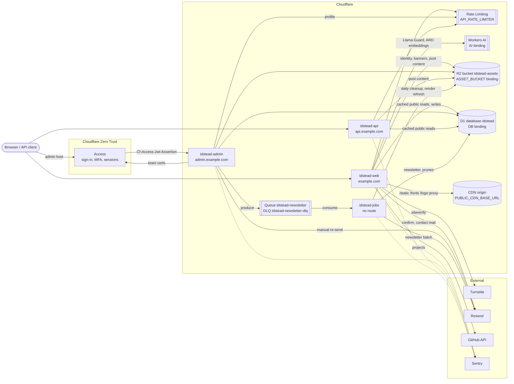

# 1. Component Map

The four Workers, what they talk to, and which direction each call goes.

## Notes

- **Workers** (`apps/*/wrangler.jsonc`):
    - `idstead-web` serves `example.com` and `www.example.com`, which is redirected to the apex.
    - `idstead-admin` serves `admin.example.com`.
    - `idstead-api` serves `api.example.com`.
    - `idstead-jobs` sets `workers_dev: false` and has no route. Its `fetch` handler returns 404.
- **R2 is a Worker binding.** web, admin and jobs declare `r2_buckets` binding `ASSET_BUCKET` → the `assetBucket` from `idstead.jsonc` (default `idstead-assets`) (`remote: true`, so local dev reaches the real bucket). `packages/lib/src/server/r2.ts` wraps it. The Workers no longer use `@aws-sdk/client-s3` or the `R2_*` secrets; only `scripts/migrate-cdn-layout.ts`, which runs with bun outside Workers, still uses the S3 API.
- **`API_RATE_LIMITER` is the Workers Rate Limiting binding** (`ratelimits`, 60 requests per 60 s). It is namespace `1001` on web, `1002` on api and `1003` on admin (profile writes). When the binding is missing, `packages/lib/src/server/rateLimit.ts` falls back to an in-memory window.
- **Queue:** admin publishes to `idstead-newsletter` through the `NEWSLETTER_QUEUE` producer. Jobs consumes it with batch size 10, 5 retries, and DLQ `idstead-newsletter-dlq`, and also consumes the DLQ to report each dead-lettered message to Sentry.
- **Cron:** jobs has two schedules from `idstead.jsonc` (UTC). `jobs.cron` (`17 3 * * *`) runs the asset cleanup, the post render refresh and the prunes of week-old pending subscriptions and month-old activity log rows; `jobs.hourlyCron` (`37 * * * *`, passed to the Worker as `HOURLY_CRON`) prunes login failures older than a day. The prunes go through `MaintenanceStore` (`@idstead/data`), which calls the `db_prune_*` functions. Nothing runs inside the database on a schedule.
- **Sentry** is reached through the SDKs: `@sentry/sveltekit` on web and admin, `@sentry/cloudflare` on api and jobs.

## Source

- `apps/web/wrangler.jsonc`, `apps/admin/wrangler.jsonc`, `apps/api/wrangler.jsonc`, `apps/jobs/wrangler.jsonc`
- `packages/lib/src/server/r2.ts`, `rateLimit.ts`, `newsletterQueue.ts`
- `apps/jobs/src/index.ts`
- `packages/lib/src/server/data.ts` (`dataStores()`), `packages/data/src/d1/`
