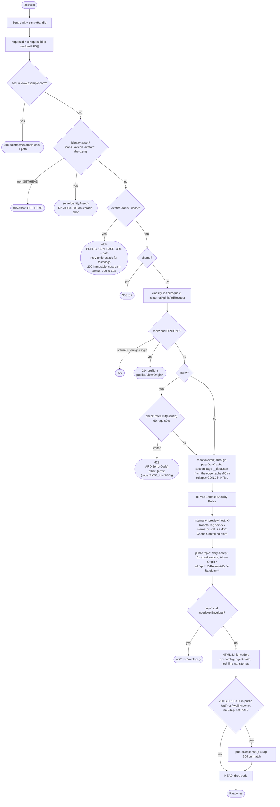

# 2. Web Worker (idstead-web) Request Pipeline

The order of work in `apps/web/src/hooks.server.ts`. It runs as `sequence(sentryInitHandle, Sentry.sentryHandle(), <inline handler>)`.

## Notes

- Identity assets, the CDN proxy, redirects, preflight and 429 all **return early**. None of the later header steps run for them.
- **Cross-origin `/api/internal/*`:**
    - The hook rejects these requests only for `OPTIONS` preflight (403).
    - Each internal handler enforces same-origin itself through `isSameOriginRequest()` (`packages/lib/src/server/sameOrigin.ts`).
- **Rate limiting:**
    - It applies only to `/api/*`, after the preflight check.
    - `API_RATE_LIMITER` is the Workers Rate Limiting binding (namespace `1001`).
    - Without the binding, an in-memory fallback is used.
- **Preview hosts** are `PUBLIC_SENTRY_ENVIRONMENT=preview`, `*.pages.dev` and `*.workers.dev`.
- **Errors:** `handleError` is `Sentry.handleErrorWithSentry()`.

## Source

- `apps/web/src/hooks.server.ts`
- `packages/lib/src/server/profileAssets.ts` (`assetNames`, `serveIdentityAsset`)
- `packages/lib/src/server/rateLimit.ts`, `csp.ts`, `apiEnvelope.ts`, `publicResponse.ts`, `pageDataCache.ts`
