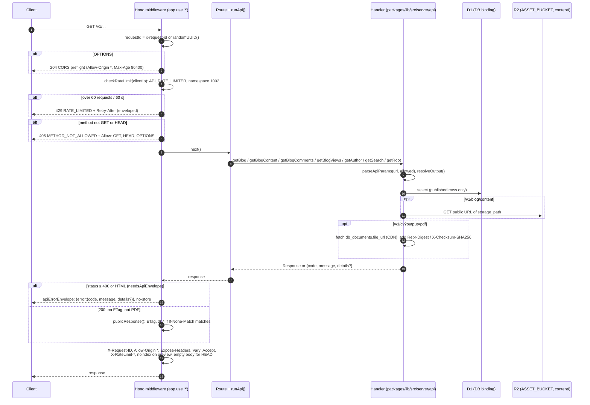

# 5. Public API Worker (idstead-api)

How a request moves through the Hono worker at `api.example.com`. Endpoints, parameters, response shapes and error codes are in **[docs/004-api/001-v1](../004-api/001-v1/README.md)**.

## Notes

- **Read-only public repositories:**
    - The worker only builds `dataStores({ env }, { bannerUrls: false }).public`, the published and public rows.
    - Post content is read from the `ASSET_BUCKET` R2 binding.
- **Fallback handlers:**
    - `app.notFound` returns `NOT_FOUND`.
    - `app.onError` reports to Sentry and returns `INTERNAL_ERROR`. Both are wrapped by the envelope.
- **OpenAPI:** `/v1/openapi.json` and `/v1/openapi.yaml` come from `packages/lib/src/openapi.ts`, with `servers` set to the request origin and `s-maxage=300`.
- **Root routes:** `/` redirects 301 to `/v1`. `/robots.txt` allows everything.

## Source

- `apps/api/src/index.ts`
- `packages/lib/src/server/api/{blog,author,root,params,responses}.ts`
- `packages/lib/src/server/apiEnvelope.ts`, `publicResponse.ts`, `rateLimit.ts`
