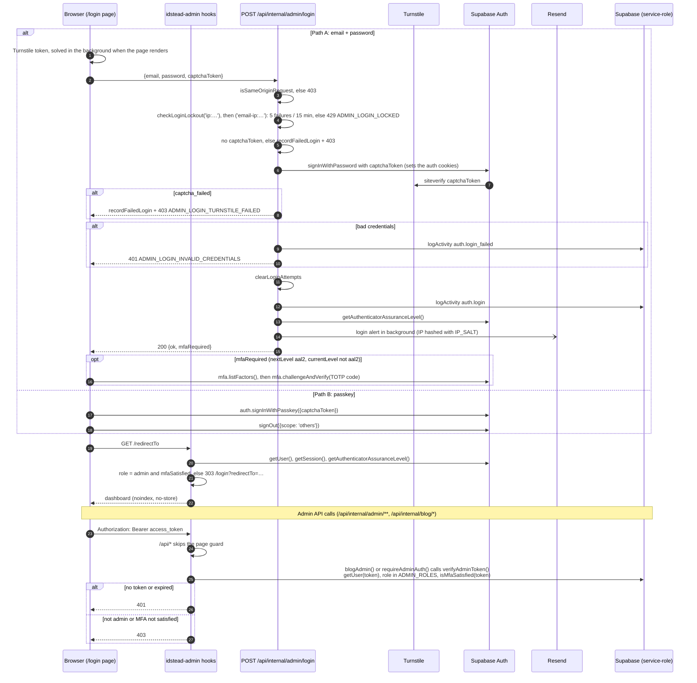

# 6. Admin Login, MFA and Request Auth

How the admin signs in at `admin.example.com`, and how pages and API calls are authorised afterwards.

## MFA rule

`requiresAdminMfa()` in `packages/lib/src/adminAuthState.ts` decides whether a session is MFA-satisfied:

- A **passkey session** is MFA-satisfied. A session counts as passkey when its authentication methods include `passkey`, `webauthn` or `mfa/webauthn`.
- Any other session needs MFA only when `nextLevel === 'aal2'` and `currentLevel !== 'aal2'`.

The retired Postgres schema enforced the same rule in `public.is_admin()`; on D1 the admin endpoints apply it in code before they write (migration `20261012121000_is_admin_accepts_passkey.sql`). It returns true when the JWT has `app_metadata.role = 'admin'` **and** any one of these holds:

- `aal = 'aal2'`;
- an `amr` entry has `method = 'passkey'`;
- the user has **no verified** MFA factor.

## Notes

- **Unguarded paths:** the page guard in `hooks.server.ts` skips `/login`, `/robots.txt`, `/api/*`, `/_app/*` and identity assets. API routes authenticate themselves.
- **Auth cookies:**
    - They are host-only on `admin.example.com`, set by `@supabase/ssr` through `createAuthClient` (`packages/lib/src/server/supabaseAuth.ts`).
    - Options are `path=/`, `sameSite=lax`, and `secure` on HTTPS.
    - The code spreads the `@supabase/ssr` options and overrides only those three. It does not set `httpOnly` itself.
- **Login lockout:** `packages/lib/src/server/loginRateLimit.ts` counts failures in `db_login_failures` through the `service_role` RPCs `db_login_lockout`, `db_login_record_failure` and `db_login_clear`, so every isolate shares one count. Keys (`ip:…`, `email-ip:…`, `password-change:…`) are stored only as salted SHA-256 hashes. If the RPC fails, the isolate's in-memory `Map` is used instead.
- **Supabase Auth CAPTCHA:** the browser can call Supabase Auth directly (`/auth/v1/token`, passkey sign-in), skipping this route's lockout. Every sign-in therefore forwards one Turnstile token as `captchaToken`: the login route, the passkey button and the `data/delete-all` password check. Supabase verifies it only when **CAPTCHA protection** is enabled in the Supabase dashboard (Authentication → Attack Protection, provider Turnstile, the production `TURNSTILE_SECRET`); until then neither path checks the token, and the route rejects only a missing one. A Turnstile token can be verified once, so the route does not call `siteverify` itself: Supabase is the single verifier. The login widget renders with `execution: 'render'`, so the token is solved in the background while the page loads and the button submits without waiting; after each attempt the widget resets and solves a fresh token.
- **`data/delete-all`** re-checks the password with a per-request client, behind the shared lockout (`delete-all:…`).
- **`logout`** checks same-origin only. **`password`** uses `blogAdmin()` plus the lockout.
- **Page responses:** every admin response gets `X-Robots-Tag: noindex, nofollow` and `Cache-Control: no-store`.

## Source

- `apps/admin/src/hooks.server.ts`, `apps/admin/src/routes/(admin)/+layout.server.ts`, `(admin)/login/+page.svelte`
- `apps/admin/src/routes/api/internal/admin/login/+server.ts`
- `packages/lib/src/server/adminAuth.ts`, `blogPostAuth.ts`, `adminCv.ts` (`requireAdminAuth`), `loginRateLimit.ts`, `supabaseAuth.ts`
- `packages/lib/src/adminAuthState.ts`
