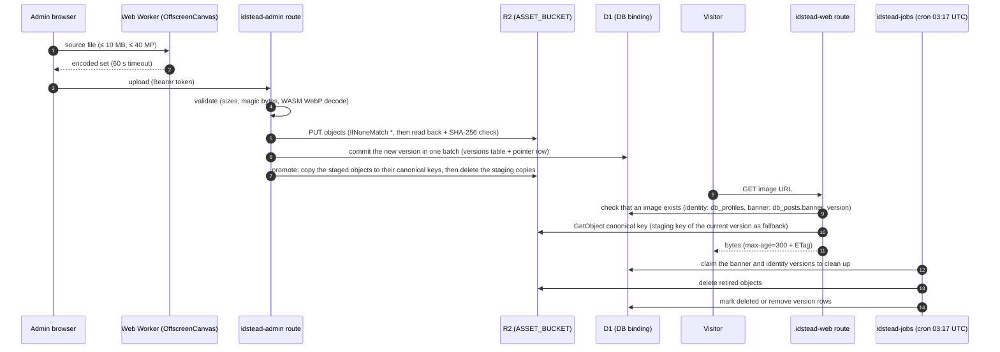

# 8. Image Pipeline: Encode, Validate, Store, Serve, Clean Up

Images are encoded **in the browser**, validated again on the server, written to R2 through the `ASSET_BUCKET` binding (`packages/lib/src/server/r2.ts`), served by idstead-web routes, and cleaned up by idstead-jobs. Markdown bodies are stored in the same bucket under `content/posts/`.

## Asset types

| Asset | Encoder (packages/lib/src) | Server check | R2 key | Served at |
| --- | --- | --- | --- | --- |
| Avatar + icons | `processAvatar.ts` → `workers/avatar.worker.ts`: PNG icon set, `favicon.ico`, SVG, `avatar.webp`, `avatar.avif` (both required) | `validateAvatar.ts`: PNG structure/CRC, ICO directory, WebP/AVIF magic bytes (AVIF checks `ftyp` brand), SVG rebuilt | `identity/{name}`, next to the website banner | `/{name}` and `/hero.png`, handled in the web and admin hooks by `serveIdentityAsset()` |
| Blog banner | `processBanner.ts` → `workers/banner.worker.ts`: WebP + AVIF 1280×640, ≤ 500 KiB | WebP: `validateBanner.ts` (WASM decode); AVIF: `inspectAvif` | `{home}/banner.{avif,webp}` | CDN URL, AVIF first with WebP fallback (`bannerSources()`) |
| Markdown image | `processContentImage.ts` → `workers/contentImage.worker.ts`: WebP + AVIF, max edge 2400, ≤ 500 KiB | `validateContentImage.ts` (`inspectWebp` + WebP decode) and `validateContentImageAvif` | `{home}/images/{name}.{avif,webp}` | CDN URL; markdown links the `.avif`, rendered as `<picture>` with the `.webp` fallback |
| Markdown video | uploaded as-is, **WebM only** (EBML header with DocType `webm`, `isWebm()`) | `admin/blog/content-video` route | `{home}/videos/{name}.webm` | CDN URL, rendered as `<video>` |
| Website banner | `processSiteBanner.ts` → `workers/siteBanner.worker.ts`: `banner.avif`, `banner.webp` (1280×640), `banner-og.webp` (1200×630) | `validateSiteBanner.ts`: `inspectAvif` / `inspectWebp` with exact dimensions | `identity/{name}`, next to the avatar | `/banner.{avif,webp}`, `/banner-og.webp` → `serveIdentityAsset()` |
| Resume PDF | generated server-side (`pdfGenerator.ts`) | – | `resume/{filename}` plus `.sha256`, `.sha512`, `.md5`, `.b2` and an optional `.asc` (see [011-resume-documents.md](011-resume-documents.md)) | `db_documents.file_url` (CDN URL), streamed by `/v1/resume?output=pdf` |
| Post Markdown | – | – | R2 `content/posts/{postUuid}/{operationId}.md` | read by page loads and the API |

## Blog post assets

- **Home folder.** A published post keeps its files in `blog/{slug}/` and a draft in `staging/blog/{postUuid}/`, with the same layout: `banner.{avif,webp}`, `images/{name}.{avif,webp}`, `videos/{name}.webm` (`postAssetHome()` in `blogBanner.ts`). Blog assets are served straight from the public CDN (`PUBLIC_CDN_BASE_URL`); there is no Worker route for them.
- **Reserved slugs.** `banners` and `content` are not valid post slugs (`slugifyTitle()` turns them into `banners-post` / `content-post`), so a post folder never collides with the shared `blog/banners/` staging keys. Publishing with a slug another post already owns is rejected before any file is copied.
- **Uploads** from the editor always land in `staging/blog/{postUuid}/`. The file name is `assetFileName()` of the original name, with `-2`, `-3`… when the staging or published folder already has that name. The editor creates the post ID before the first save and keeps it in the autosave.
- **On save** (`relocateMarkdownAssets()`, before the markdown is stored): every CDN URL in the markdown that points to this post's staging folder or its previous home is copied to the post's new home and rewritten, so the stored markdown always has final URLs. The response returns the rewritten markdown to the editor.
- **After the commit** (`syncPostAssets()`): the new banner moves from its version staging key to `{home}/banner.*` (or the old home's banner moves when the slug or the published state changed, and a banner still in the staging folder moves when the home has none), files in the home that the markdown no longer uses are deleted, the old home is deleted, and for a published post the whole staging folder is deleted. Deleting a post deletes its home and staging.
- **Publishing or unpublishing from the post list** (`posts/flags`) changes the home without a save, so it moves only the banner (`movePostBanner()`); the markdown still links to the old home, whose files stay until the next save relocates them.
- **Orphaned staging** (uploads for posts that were never saved) is deleted by the jobs cron after 7 days without changes (`cleanupOrphanedStaging()`).
- **Export** (`dataExport.ts`) writes every post under the same path as on the CDN, with relative links in its markdown.

## Serving rules

- **One image per owner, no versions in URLs.** The site keeps one profile image, one website banner and one banner per post, each in several formats. Public URLs never carry a version, and any identity request with `?v` returns 404.
- **Staging and promotion.** Saves still upload to a staging key per version (`identity/{version}/{name}`, `blog/banners/{postUuid}/{operationId}.{ext}`) so a failed or conflicting save never touches the live image. After the DB commit the admin route copies the staged files to the canonical key (`promoteIdentity()`, `syncPostAssets()`) and deletes the staging copies. A partial identity save first copies the unchanged group from the canonical keys into the new staging folder (`copyAssets()`).
- **Fallback.** If promotion failed, serving falls back to the staging key of the current version (`readIdentityObject()`), which is only deleted after a successful copy.
- **Identity assets** (`serveIdentityAsset`, `packages/lib/src/server/profileAssets.ts`): 13 files (`identityAssetNames` in `siteIdentity.ts`). `db_profiles.avatar_version` and `banner_version` only say that an image exists. When no version exists yet: fallback to `PUBLIC_CDN_BASE_URL/{name}`.
- **Cache:** images are `public, max-age=300` (`IMAGE_CACHE_CONTROL`) with the R2 ETag, so a change shows within about 5 minutes and revalidations return 304. The admin editors show the locally prepared image right after a save.

## Cleanup

- **`cleanupBlogAssets`** (`blogBannerStorage.ts`):
    - Banners: claims retired banner versions, deletes the `.webp` and `.avif` objects, and sets `state='deleted'`. On failure it records `cleanup_error`.
    - Markdown: removes orphaned files listed in `db_post_storage_cleanup` that are more than 24 h old and no longer referenced by `db_posts.storage_path`. Each file's `.render.json` (the stored MDRS render) is removed with it.
- **`cleanupAssets`** (`profileAssets.ts`): claims retired identity versions, deletes any leftover staging objects in `identity/{id}/`, then deletes the version row. `data/delete-all` also removes the canonical identity files and post banners.
- **Callers:** the jobs cron, admin `posts` (`cleanupBlogAssets` after a save), `profile` (`cleanupAssets` after a save), and `data/delete-all`.

## Source

- `packages/lib/src/process*.ts`, `packages/lib/src/workers/*.worker.ts`
- `packages/lib/src/server/validate*.ts`, `r2.ts`, `profileAssets.ts`, `blogBannerStorage.ts`, `blogContentStorage.ts`
- `packages/lib/src/blogBanner.ts`, `blogContentImage.ts`, `siteIdentity.ts`
- `packages/lib/src/server/blogPostAssets.ts`, `packages/domain/src/assetNaming.ts`, `packages/lib/src/cdn.ts`
- `apps/admin/src/routes/api/internal/admin/{profile,blog/content-image,blog/content-video}/+server.ts`
