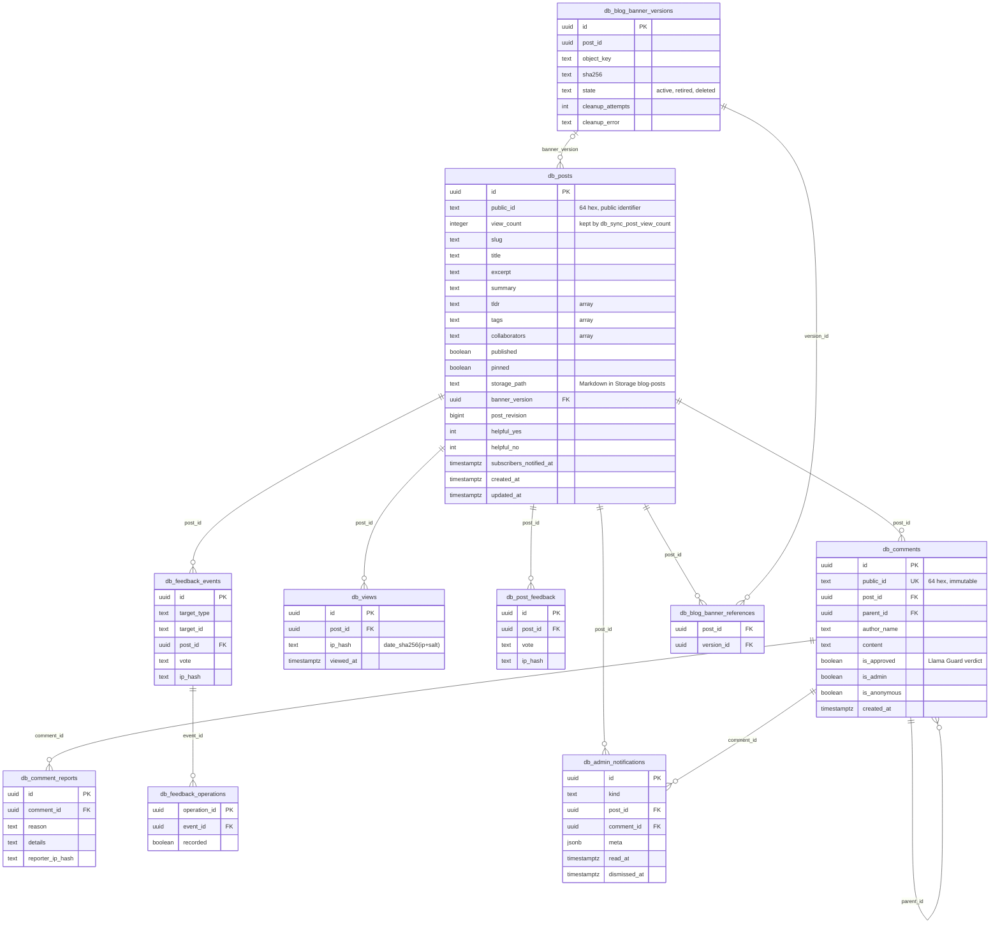
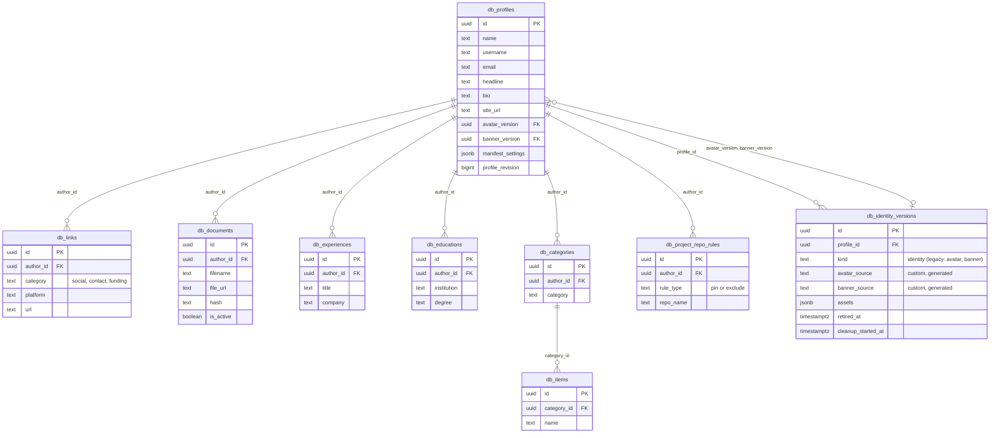

# 9. Database Schema

The public tables in the Supabase project, with their relationships. The diagrams list key columns only. Source: the live `information_schema` on 2026-10-15. All tables use the `db_` prefix, introduced in migration `20260810`.

> Production was migrated partly through the Supabase MCP tool, so recorded migration versions differ from the file names in `supabase/migrations/`, and the original `create table` statements are not in the repo. Check the live schema before assuming a migration is applied. Re-generate this page with `information_schema.columns` and the foreign-key query in [Maintenance](#maintenance).

## Content



## Author profile



## Operations and standalone tables

| Table | Purpose |
| --- | --- |
| `db_post_operations` | Idempotent post saves keyed by `operationId`: `state`, `request_hash`, `expected_revision`, `result`. |
| `db_post_storage_cleanup` | Markdown files queued for deletion from Storage (each removed together with its `.render.json`), with `cleanup_attempts`. |
| `db_subscribers` | Newsletter subscribers: `email`, `status` (pending, active, unsubscribed), `confirm_token_hash`, `unsubscribe_token`, `ip_hash`. |
| `db_activity_log` | Admin audit log: `actor`, `action`, `category`, `entity_id`, `summary`, `details`, `ip_hash`. Rows older than 30 days are pruned by the jobs Worker's daily cron. |
| `db_login_failures` | Shared admin login lockout: `key_hash` (salted SHA-256 of `ip:`, `email-ip:` or `password-change:` keys), `failed_at`. RLS on with no policies; reached only through `service_role` RPCs. Pruned by `pg_cron` `prune-login-failures`. |
| `db_admin_settings` | Per-user admin settings (`user_id`, `settings jsonb`). |
| `db_notification_clear_operations` | Idempotent "clear notifications" operations. |
| `db_legals` | Legal pages (`slug`, `title`, `content`). |
| `db_ard_index` | ARD discovery index (`site_url`, `entries`, `sources`), service-role only. |

## Functions, policies and jobs

- **`public.is_admin()`** is the RLS predicate for admin writes. See [006-admin-login-mfa.md](006-admin-login-mfa.md#mfa-rule).
- **Post saves:** `db_prepare_post_operation`, `db_ready_post_operation`, `db_commit_post_operation`. The commit stores `read_time` when the operation data carries one; the admin save route sets it to `countReadingMinutes()` of the final markdown.
- **Public IDs:** posts and comments carry an immutable 64-hex `public_id` (trigger `db_keep_post_public_id`); page data, the API and the comment and report endpoints use it, never the UUID.
- **View counts:** `db_posts.view_count` is the public count. The `db_sync_post_view_count` trigger (`SECURITY DEFINER`) adds one for every `db_views` insert and removes one for every delete, and the unique index on `(post_id, ip_hash)` makes a repeated visit a no-op (`ON CONFLICT DO NOTHING`). `db_views` itself, with the salted daily `ip_hash`, is private: `anon` has no grant and no policy, and only the service role and the admin policy read it. A column grant was tried first and reverted (`20261020000000_restore_view_grants`) because PostgREST's embedded `db_views(count)` needs table-level `SELECT`.
- **Cleanup claims:** `db_claim_blog_banner_cleanup`, `db_claim_identity_cleanup`.
- **Saves:** `db_save_cv`, `db_save_links`, `db_save_skills`, `db_save_legal`, `db_save_project_repo_rules`.
- **Public:** `db_record_page_feedback`.
- **Login lockout** (`service_role` only): `db_login_lockout`, `db_login_record_failure`, `db_login_clear`, `db_prune_login_failures`.
- **Admin dashboard:** `db_admin_*`, `db_views_timeseries`, `db_activity_log_list`, `db_activity_log_export`, `db_clear_all_data`, `db_subscriber_stats()` (a **function**, not a table).
- **Profile identity save:** `db_save_profile_identity(p_profile, p_identity)` (`service_role` only). `p_identity` is `{version, assets}` for one `kind = 'identity'` row whose assets must match `db_identity_asset_names()` exactly. It points `avatar_version` and `banner_version` at that row and retires the previous rows. The `db_profile_identity_kind` trigger rejects a profile whose two columns differ while either references an `identity` row.
- **`safeupdate`:** PostgREST runs with `safeupdate`, so every `UPDATE`/`DELETE` inside a function needs a `WHERE` clause. `tests/safeupdate.test.ts` checks this.
- **Prunes** (`service_role` only): `db_prune_stale_subscriptions`, `db_prune_activity_log` and `db_prune_login_failures`, called by the jobs Worker's cron through `MaintenanceStore`.

## D1 schema

The same tables also exist as a Cloudflare D1 (SQLite) schema in `packages/data/d1/migrations/`, which the D1 adapters will use after the move off Supabase; until the cutover the site still reads and writes Supabase. `0001_init.sql` was written from the live schema above, with these conversions:

- **Types:** UUIDs, timestamps and dates are `TEXT` (UUIDs default to a random v4, timestamps to ISO 8601 UTC with milliseconds, `public_id` to 64 random hex characters); booleans are `INTEGER` 0 or 1; `jsonb` and `text[]` are JSON `TEXT` checked with `json_valid` and `json_type`.
- **Checks:** D1 has no regular expressions, so pattern checks use `GLOB` (for example `public_id NOT GLOB '*[^0-9a-f]*'`), and checks that need a subquery (the length of each tag and TL;DR point) are `BEFORE` triggers.
- **Triggers:** every Postgres trigger has a SQLite equivalent (`RAISE(ABORT, ...)` for the guards), except the banner-version guard against the `anon` and `authenticated` roles, which has no meaning without browser access to the database. `start_date` and `end_date` on experiences and educations are generated columns.
- **Counters:** `view_count`, `helpful_yes` and `helpful_no` move from `db_posts` to `db_post_stats`, so recording a view never changes a post row.
- **Read cache:** `db_cache_generations` holds one generation per cached domain (`author`, `blog`, `legal` and `comments:<post id>`), bumped by triggers on every write to the tables behind it.
- **Dropped:** the full-text (`gin`) indexes and the foreign key from `db_admin_settings` to `auth.users`.

`tests/d1Schema.test.ts` loads every migration into SQLite and checks that each column of the live Postgres schema (`tests/fixtures/postgresColumns.json`) still exists and that the triggers behave as before. Apply a migration to a D1 database with `bunx wrangler d1 execute <database> --remote --file <migration>`.

## Maintenance

```sql
select table_name, string_agg(column_name || ':' || data_type, ', ' order by ordinal_position)
from information_schema.columns where table_schema = 'public' group by 1 order by 1;

select tc.table_name, kcu.column_name, ccu.table_name as references_table
from information_schema.table_constraints tc
join information_schema.key_column_usage kcu using (constraint_name, table_schema)
join information_schema.constraint_column_usage ccu using (constraint_name, table_schema)
where tc.constraint_type = 'FOREIGN KEY' and tc.table_schema = 'public';
```

## Source

- Live Supabase schema (`information_schema`, `cron.job`)
- `supabase/migrations/`
- `tests/safeupdate.test.ts`
