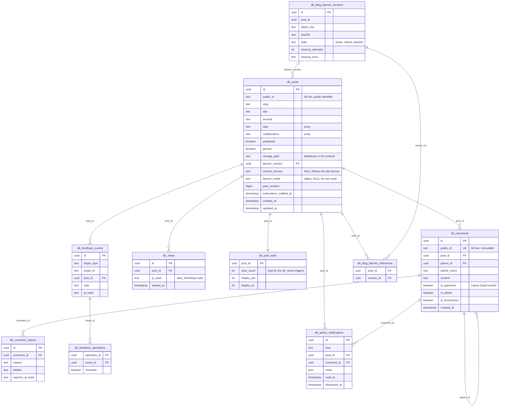
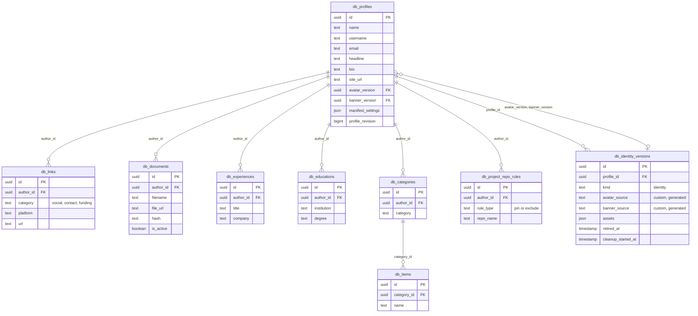

# 9. Database Schema

The tables of the site, with their relationships. The schema is Cloudflare D1 (SQLite), defined by the migrations in `packages/data/d1/migrations/`; every table uses the `db_` prefix. The diagrams list key columns only, with their logical types: in D1, UUIDs, timestamps and JSON are `TEXT` and booleans are `INTEGER` ([Types and checks](#types-and-checks)). Only the D1 adapters in `packages/data/src/d1/` query these tables.

## Content



## Author profile



## Operations and standalone tables

| Table | Purpose |
| --- | --- |
| `db_post_operations` | Idempotent post saves keyed by `operationId`: `state`, `request_hash`, `expected_revision`, `result`. |
| `db_post_storage_cleanup` | Markdown files queued for deletion from R2 (each removed together with its `.render.json`), with `cleanup_attempts`. |
| `db_subscribers` | Newsletter subscribers: `email`, `status` (pending, active, unsubscribed), `confirm_token_hash`, `unsubscribe_token`, `ip_hash`. |
| `db_activity_log` | Admin audit log: `actor`, `action`, `category`, `entity_id`, `summary`, `details`, `ip_hash`. Rows older than 30 days are pruned by the jobs Worker's daily cron. |
| `db_lockout_failures` | Shared lockout for failed OpenID Connect client secrets: `key_hash` (salted SHA-256 of the lockout key), `failed_at`. Reached only through `LockoutStore`; the jobs Worker's daily cron prunes old rows. |
| `db_admin_settings` | Per-user admin settings (`user_id`, `settings json`). |
| `db_notification_clear_operations` | Idempotent "clear notifications" operations. |
| `db_legals` | Legal pages (`slug`, `title`, `content`). |
| `db_ard_index` | ARD discovery index (`site_url`, `entries`, `sources`), service stores only. |
| `db_site_settings` | Site-wide settings by `key`: `analytics` ([Analytics and consent](013-analytics-and-consent.md)) and `contentLicense` ([Content licensing](014-content-licensing.md)), each a JSON object of at most 2048 bytes. |
| `db_cache_generations` | One generation per cached domain (`author`, `blog`, `legal`, `site` and `comments:<post id>`), bumped by triggers on every write to the tables behind it. |

## Triggers and data stores

The writes run in the D1 data stores (`packages/data/src/d1/`), each as one `batch()` so it is atomic. Triggers keep the invariants that every writer must respect:

- **Admin writes:** every admin endpoint verifies the Cloudflare Access identity before it writes; see [006-admin-sign-in.md](006-admin-sign-in.md). D1 has no row-level security, so public writes are same-origin and Turnstile-gated ([Public write endpoints](004-public-write-endpoints.md)).
- **Post saves:** `db_post_operations` makes each save idempotent by `operationId`; `db_posts_revision` bumps `post_revision`, and the store refuses a save at a stale revision. The save stores `read_time` from the final markdown.
- **Public IDs:** posts and comments carry an immutable 64-hex `public_id` (`db_posts_keep_public_id`, `db_comments_keep_public_id`); page data, the API and the comment and report endpoints use it, never the UUID.
- **Counters:** `db_posts_create_stats` adds the `db_post_stats` row. `db_views_count_insert` and `db_views_count_delete` move `view_count`, and the unique index on `(post_id, ip_hash)` makes a repeated daily visit a no-op. The feedback store moves `helpful_yes` and `helpful_no` in the batch that records the vote in `db_feedback_events`.
- **Limits and checks:** `db_posts_pin_limit_*` and `db_links_category_limit_*` cap pinned posts and links per category; `db_posts_validate_lists_*` check tags and collaborators; `db_posts_excerpt_on_*` fill the excerpt.
- **Profile identity:** `db_profiles_identity_kind` keeps `avatar_version` and `banner_version` on the same `identity` row, `db_profiles_retire_images` retires the previous rows, and `db_profiles_revision` bumps `profile_revision`.
- **Notifications:** `db_comments_notify`, `db_comment_reports_notify` and `db_feedback_events_notify` add `db_admin_notifications` rows; the views `db_admin_notification_items`, `db_admin_feedback_items` and `db_admin_report_items` shape the inbox.
- **Read cache:** the `*_cache_insert`, `*_cache_update` and `*_cache_delete` triggers bump the domain's row in `db_cache_generations`.
- **Prunes:** the jobs Worker's daily cron prunes stale subscriptions, activity log rows older than 30 days and old lockout failures through `MaintenanceStore`.

## Types and checks

- **Types:** UUIDs, timestamps and dates are `TEXT` (UUIDs default to a random v4, timestamps to ISO 8601 UTC with milliseconds, `public_id` to 64 random hex characters); booleans are `INTEGER` 0 or 1; JSON values and lists are `TEXT` checked with `json_valid` and `json_type`.
- **Checks:** D1 has no regular expressions, so pattern checks use `GLOB` (for example `public_id NOT GLOB '*[^0-9a-f]*'`), and checks that need a subquery (the length of each tag) are `BEFORE` triggers that `RAISE(ABORT, ...)`. `start_date` and `end_date` on experiences and educations are generated columns.

### OpenID Connect tables

`0003_oidc.sql` adds the tables behind "Sign in with Idstead" (the OpenID Connect provider). They are reached only through `OidcClientStore` and `OidcAuthStore` (`packages/data/src/oidc.ts`), are never cached, are left out of the data export (they hold credentials), and are emptied by delete-all except the subject.

| Table | Contents |
| --- | --- |
| `db_oidc_subject` | One row: the instance's random `subject` (32 hex), the `sub` claim of every token. Kept by delete-all so connected apps still recognise the owner. |
| `db_oidc_clients` | Registered apps: public `client_id`, `name`, `redirect_uris` (JSON array, 1–10), `secret_hash` (SHA-256 of the client secret; `NULL` for public clients that use PKCE only). |
| `db_oidc_grants` | Consent per client: random `public_id`, `scopes` (JSON array), `created_at`, `last_used_at`, `revoked_at`. A partial unique index allows one active grant per client. |
| `db_oidc_codes` | Authorization codes by `code_hash`, with the grant, `redirect_uri`, `scopes`, `nonce`, the S256 `code_challenge`, `auth_time`, `expires_at` and `used_at`. Spending a code twice revokes its grant. |
| `db_oidc_refresh_tokens` | Refresh tokens by `token_hash`, with the grant, `scopes`, `auth_time`, `expires_at`, `rotated_at` and `revoked_at`. Each use rotates the token; presenting a rotated one revokes the whole grant. |

## Migrations

| Migration | Change |
| --- | --- |
| `0001_init.sql` | The schema |
| `0002_admin_views.sql` | The admin inbox views |
| `0003_oidc.sql` | The OpenID Connect tables |
| `0004_drop_post_summary.sql` | Drops the post summary column |
| `0005_rename_cv_to_resume.sql` | Renames the `cv` activity category and actions to `resume`, and moves document URLs from `/cv/` to `/resume/` |
| `0006_lockout_failures.sql` | Renames the lockout table to `db_lockout_failures` |
| `0007_site_settings.sql` | Adds `db_site_settings`, the `site` cache generation and the `settings` activity category, and files `auth` entries under `security` |
| `0008_drop_post_feedback.sql` | Stores feedback votes only in `db_feedback_events` |

`tests/d1Schema.test.ts` loads every migration into SQLite and checks that each table the adapters query exists, with its defaults and constraints; `tests/feedbackMigration.test.ts` checks that `0008` keeps every vote and operation. Apply new migrations with `bunx wrangler d1 migrations apply <database> --remote` from `apps/web`, and to the shared local database used by the dev servers with `bun run db:local`. A migration that drops a column or table ships with the release that stops reading it.

## Inspecting the schema

```sh
bunx wrangler d1 execute DB --remote --command "SELECT type, name FROM sqlite_master WHERE name LIKE 'db_%' ORDER BY type, name"
bunx wrangler d1 execute DB --remote --command "PRAGMA table_info(db_posts)"
```

## Source

- `packages/data/d1/migrations/`
- `packages/data/src/d1/`
- `tests/d1Schema.test.ts`, `tests/feedbackMigration.test.ts`
