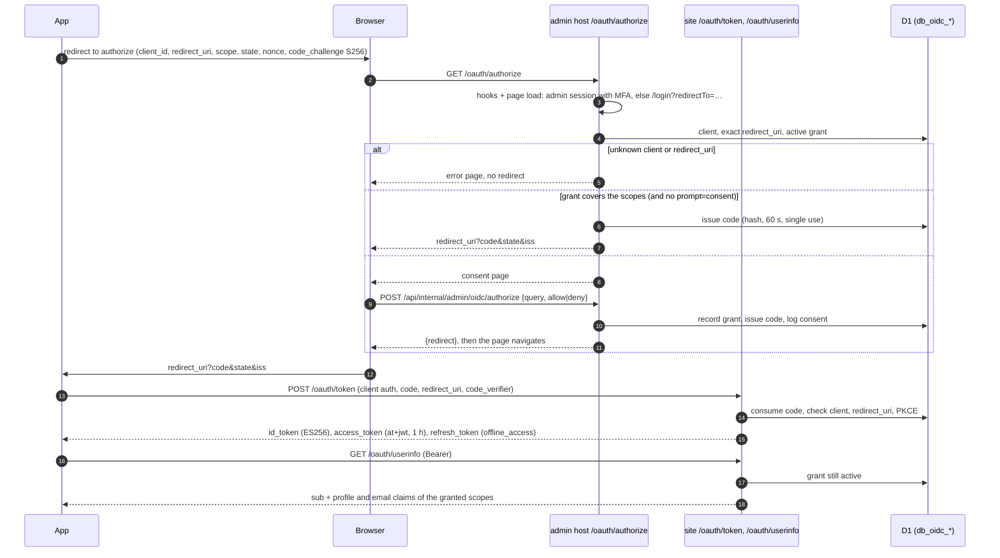

# 12. Identity Provider

Every instance is the identity home of its owner. Other apps can find the owner by address (WebFinger), show their avatar from an email hash (like Gravatar), and let them **Sign in with Idstead** through OpenID Connect. The instance has exactly one subject, its owner; every token describes that owner.

## Discovery

| Route (site host) | Answers |
| --- | --- |
| `/.well-known/webfinger?resource=…` | `acct:<username>@<site host>`, `acct:<email local part>@<site host>` when the profile email is on the site's domain, or the site URL itself. Links: `http://webfinger.net/rel/profile-page`, `http://webfinger.net/rel/avatar` (when the profile has its own avatar) and `http://openid.net/specs/connect/1.0/issuer` (when a signing key is set), filtered by `rel`. |
| `/.well-known/openid-configuration` | Issuer, endpoints, `S256`, `ES256`, scopes and claims. 404 without `OIDC_SIGNING_KEY`. |
| `/.well-known/jwks.json` | The public half of `OIDC_SIGNING_KEY`, with its RFC 7638 thumbprint as `kid`. |
| `/avatar/<hash>` | The avatar when `<hash>` is the SHA-256 or MD5 of the trimmed, lowercased profile email; `s`/`size` picks the smallest stored size at least that large (16 to 512, default 80). 404 otherwise. |

All of them answer with `Access-Control-Allow-Origin: *`.

## Sign in with Idstead

The issuer is the site origin (`PUBLIC_SITE_URL`). Authorize and consent run on the admin host, where the admin session lives (`PUBLIC_ADMIN_URL`, falling back to `admin.<site host>`); token, userinfo and revoke run on the site.

### Choices

- **Flow:** authorization code only, with PKCE `S256` required for every client. No implicit or hybrid flow, no `client_credentials`, and no request objects. The authorization response carries `iss` (RFC 9207).
- **Clients** are registered by hand in the admin under **Identity → Connected apps**. They are either confidential (`client_secret_basic` or `client_secret_post`, with the secret shown once and stored as SHA-256) or public (`none`, protected by PKCE). Redirect URIs match exactly and must use `https`, or `http` on `localhost`, `127.0.0.1` or `[::1]`.
- **Consent** is shown unless an active grant for the app already covers the requested scopes. `prompt=consent` always shows it, `prompt=none` without a grant answers `consent_required`, and `prompt=login` answers `login_required` unless the admin signed in within five minutes.
- **Scopes:**
    - `openid` → `sub`, a random ID kept in `db_oidc_subject` that survives delete-all
    - `profile` → `name`, `preferred_username`, `picture`, `website`, `updated_at`
    - `email` → `email` with `email_verified: false`
    - `offline_access` → a refresh token
- **Tokens:**
    - The ID token lives 5 minutes and carries `nonce`, `auth_time` (the newest admin authentication method) and the granted claims.
    - The access token is an RFC 9068 `at+jwt` with `aud` = issuer, valid for one hour. Userinfo also checks that its grant is still active, so revoking cuts it off at once.
    - Refresh tokens live 30 days and rotate on every use. A rotated token that comes back revokes the whole grant, and so does a code spent twice or a code presented with the wrong client, redirect URI or verifier.
- **Protection:** token and revoke failures from client authentication count toward the shared lockout per client and per IP; the three `/oauth/*` routes are also rate limited per IP. Errors follow RFC 6749 and RFC 6750 with `Cache-Control: no-store`.
- **Signing key:** `OIDC_SIGNING_KEY` is a private P-256 JWK in a Worker secret, never in D1 or the data export. Without it the provider is off. Rotating the key ends every outstanding ID and access token; refresh tokens keep working.
- **Revoking:** **Connected apps → Apps with access** revokes a grant together with its refresh tokens and codes; deleting an app does the same for all of its grants. The jobs Worker prunes expired codes and refresh tokens daily.

## Source

- `packages/lib/src/server/oidc/`: `keys.ts`, `config.ts`, `webfinger.ts`, `clients.ts`, `authorize.ts`, `tokens.ts`, `endpoints.ts`, `deps.ts`, `route.ts`, `admin.ts`
- `packages/lib/src/server/avatarLookup.ts`, `packages/lib/src/server/supabaseAuth.ts` (`authTime`)
- `packages/data/src/oidc.ts`, `packages/data/src/d1/oidc.ts`, `packages/data/d1/migrations/0003_oidc.sql`
- `apps/web/src/routes/.well-known/{webfinger,openid-configuration,jwks.json}/`, `apps/web/src/routes/oauth/`, `apps/web/src/routes/avatar/[hash]/`
- `apps/admin/src/routes/(admin)/oauth/authorize/`, `apps/admin/src/routes/api/internal/admin/oidc/`, `apps/admin/src/lib/components/admin/IdentityProviderSettings.svelte`
- `tooling/oidc-key.ts`, `tooling/setup.ts`
