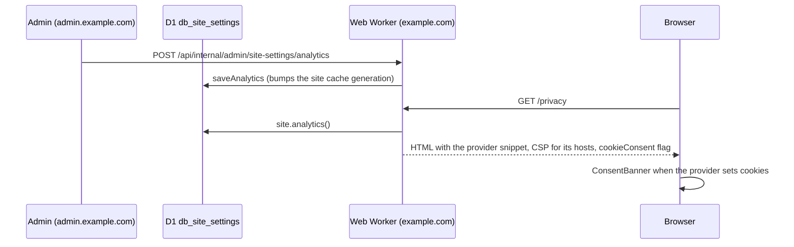

# Analytics and consent

Which analytics the public site loads, how its Content-Security-Policy and cookie banner follow that choice, and how pages read it.

The owner picks one provider in the admin under **Settings → Analytics & cookies**. The choice lives in D1, so it changes without a deploy, and no analytics ID is an environment variable.



## Providers

| Provider | Fields | Script | Cookies and banner |
| --- | --- | --- | --- |
| None | – | none | no banner, no Cookies link |
| Google Analytics 4 | Measurement ID `G-…` | `googletagmanager.com/gtag/js` | yes |
| Google Tag Manager | Container ID `GTM-…` | `googletagmanager.com/gtm.js` | yes |
| Umami | Website ID (UUID), script URL (default `https://cloud.umami.is/script.js`) | the script URL | no |
| Plausible | Script URL (default `https://plausible.io/js/script.js`) | the script URL | no |
| Cloudflare Web Analytics | Beacon token (32 hex characters) | `static.cloudflareinsights.com/beacon.min.js` | no |

- `parseAnalyticsSettings` (`packages/domain/src/analytics.ts`) validates each field. Script URLs must be `https`, point to a `.js` file, and carry no credentials or fragment. An invalid stored value reads as **None**.
- Each provider's head snippet and CSP sources come from `analyticsHead` and `analyticsSources` (`packages/lib/src/server/analytics.ts`). GA4 and GTM start with Consent Mode v2 defaults set to `denied` (or the visitor's saved choice) before the tag loads, so nothing is measured until the visitor agrees.

## Storage and API

- **Table:** `db_site_settings` (`key` = `analytics`, `value` = JSON up to 2048 bytes). No row means None. Saving bumps the `site` generation in `db_cache_generations`, so cached reads refresh at once.
- **Admin endpoint:** `GET`/`POST /api/internal/admin/site-settings/analytics`, behind `blogAdmin`. A rejected field answers `400 SITE_SETTINGS_INVALID` with the field name in `details`. Saving writes the activity log entry `settings.analytics` (category `settings`).
- **Public API:** `GET /v1/analytics` returns `{ enabled, provider, name, cookies }` without IDs, tokens or URLs ([API](../004-api/001-v1/README.md)).
- **MDRS:** `api.v1.analytics` reads the same facts, so legal pages can describe the active provider with `:::if` and `${if}` ([Live data](../008-mdrs/002-extensions/014-live-data.md#apiv1analytics)).
- The data export includes the setting, and delete-all clears it.

## Web request

- `apps/web/src/app.html` holds a `%idstead.analytics%` placeholder in `<head>`. `transformPageChunk` in `apps/web/src/hooks.server.ts` replaces it with the provider's snippet, or with nothing for None. API requests skip the lookup.
- `buildContentSecurityPolicy` (`packages/lib/src/server/csp.ts`) adds only the active provider's hosts to `script-src`, `connect-src` and `img-src`. With None, no analytics host is allowed. Umami Cloud loads its script from `cloud.umami.is` but sends events to `gateway.umami.is`, so both are allowed for it.
- The root layout load returns `cookieConsent` (whether the provider sets cookies). When it is `false`, the site renders no `ConsentBanner`, the footer has no Cookies link, and Spotlight hides the `/cookies` command.
- The visitor's choice is stored in `localStorage` under `idstead_cookie_consent_v2` and sent to the tag with `gtag('consent', 'update', …)`.

## Privacy policy text

Legal pages live in D1 and are edited in the admin. This section keeps a privacy policy in line with the setting:

```mdrs
## Analytics and cookies

:::if api.v1.analytics.cookies
This site measures visits with ${api.v1.analytics.name}. It sets analytics cookies only after you agree in the cookie banner, and you can change your choice at any time from the Cookies link in the footer.
:::elif api.v1.analytics.enabled
This site measures visits with ${api.v1.analytics.name}, which sets no cookies and stores no personal data in your browser.
:::else
This site uses no analytics and sets no analytics cookies.
:::endif
```

Source: `packages/domain/src/analytics.ts`, `packages/data/d1/migrations/0007_site_settings.sql`, `packages/data/src/d1/siteSettings.ts`, `packages/lib/src/server/analytics.ts`, `packages/lib/src/server/csp.ts`, `packages/lib/src/server/api/analytics.ts`, `apps/web/src/hooks.server.ts`, `apps/web/src/app.html`, `apps/web/src/routes/+layout.server.ts`, `apps/web/src/routes/+layout.svelte`, `apps/web/src/lib/stores/consentStore.svelte.ts`, `apps/admin/src/lib/components/admin/AnalyticsSettings.svelte`, `apps/admin/src/routes/api/internal/admin/site-settings/analytics/+server.ts`.
