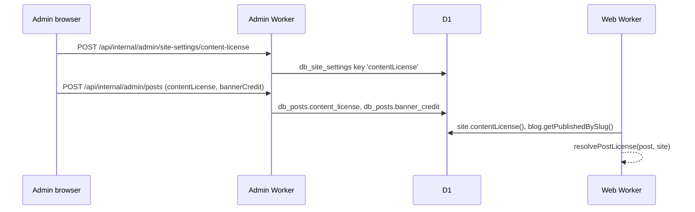

# Content licensing

Each site states the license of its own content. The site owner picks a site-wide license in the admin, each post can override it, and a post's banner can credit a creator other than the owner. The public site shows the result in the footer, below every post, in the post's text variants, in JSON-LD and in the Atom feed. The footer also links to the source code, which the AGPL-3.0 requires for modified versions run over a network ([LICENSING.md](../../LICENSING.md)).

## Licenses

`packages/domain/src/contentLicense.ts` lists the choices: `all-rights-reserved`, `CC0-1.0` and the six Creative Commons 4.0 licenses (`CC-BY-4.0` to `CC-BY-NC-ND-4.0`), each with a label, full name and deed URL. A new instance reads as `all-rights-reserved` until the owner saves a license.

## Site setting

- **Storage:** the `contentLicense` key in `db_site_settings`, `{ "license": "<id>" }`. A missing or invalid value reads as `all-rights-reserved`. Reads are cached under the `site` generation.
- **Admin:** Settings → **Content license** (`ContentLicenseSettings.svelte`, section `content` in `adminUrl.ts`) through `GET`/`POST /api/internal/admin/site-settings/content-license`, behind `blogAdmin`. A rejected value answers `400 SITE_SETTINGS_INVALID`. Saving logs `settings.contentLicense` (category `settings`).

## Post license and banner credit

- **Columns:** `db_posts.content_license` (`NULL` follows the site license) and `db_posts.banner_credit`, a JSON object or `NULL` for the owner's own work. Changing either bumps `post_revision`.
- **Banner credit:** `{ "origin": "third-party", "author", "url", "license" }` names the creator, an optional `https://` link and the banner's own license; `{ "origin": "ai-generated", "tool" }` marks an AI-generated banner, for which no license is claimed. `parseBannerCredit` validates both on save; stored values that fail validation read as own work.
- **Editor:** the post details in `PostEditor.svelte` (`PostLicenseFields.svelte`) send `contentLicense` and `bannerCredit` with the post metadata; `parsePostInput` validates them.

## Public output

| Place | Shows |
| --- | --- |
| Footer (`FooterNotice.svelte`) | "Except where otherwise noted, original content on this site is licensed under …" with the site license ("All rights reserved, except where otherwise noted." when there is none; the link carries `rel="license"` only on pages without a post notice), and a "Source (AGPL-3.0)" link when `source` is set in `idstead.jsonc` |
| Post page (`ArticleLicense.svelte`) | "Except where otherwise noted, this post is licensed under …" with the post's effective license, and the banner credit when the banner is not the owner's work |
| `/blog/{slug}.md`, `/blog/{slug}.txt` | The license notice and banner credit after the body |
| JSON-LD `BlogPosting` | `license` with the deed URL, for Creative Commons licenses |
| `atom.xml` | `<rights>` for the feed, and for each post whose license differs from the site's |

The source URL comes from `source` in `idstead.jsonc`, rendered into the web Worker as `SOURCE_URL` and read from the Worker env by `sourceCodeUrl()` in `packages/lib/src/server/siteLicense.ts`.

Source: `packages/domain/src/contentLicense.ts`, `packages/data/d1/migrations/0009_content_licensing.sql`, `packages/data/src/d1/siteSettings.ts`, `packages/data/src/d1/adminPosts.ts`, `packages/data/src/d1/blog.ts`, `packages/lib/src/server/siteLicense.ts`, `packages/lib/src/server/blogPostInput.ts`, `packages/lib/src/server/rawDocuments.ts`, `apps/admin/src/lib/components/admin/ContentLicenseSettings.svelte`, `apps/admin/src/lib/components/admin/PostLicenseFields.svelte`, `apps/admin/src/routes/api/internal/admin/site-settings/content-license/+server.ts`, `apps/web/src/routes/+layout.server.ts`, `apps/web/src/lib/layout/FooterNotice.svelte`, `apps/web/src/lib/article/ArticleLicense.svelte`, `apps/web/src/routes/blog/[slug]/+page.server.ts`, `apps/web/src/routes/atom.xml/+server.ts`.
