# Rendering pipeline

MDRS renders in two phases. File names below are relative to `packages/mdrs/core/src/`; `markdown.ts` runs the steps in order.

The two phases are a server pass that turns the source into sanitized HTML, and a browser pass that adds interactivity. Knowing the order explains most of the rules on the other pages, for example why code protects directives and why `${…}` works inside math.

## Server pass

```mermaid
flowchart TD
    A[Source] --> A1["Strip U+E000/U+E001,<br/>remove YAML frontmatter<br/>(frontmatter.ts)"]
    A1 --> B["Extract :::define block<br/>(define/block.ts)"]
    B --> C["Evaluate define entries<br/>(define/evaluate.ts, only if the block has entries)"]
    C --> D["Extract :::ignore-render blocks<br/>as escaped pre (render/ignoreRender.ts)"]
    D --> E["Protect ${…} and [text].${…}<br/>(define/interpolation.ts; only with :::define;<br/>code and \${ skipped)"]
    E --> F["Extract math<br/>$$ … $$ and :::math (render/math.ts)"]
    F --> G[Resolve interpolation]
    G --> H["Render math with KaTeX<br/>(interpolation inside formulas resolved first)"]
    H --> I["Extract :::references<br/>(references.ts)"]
    I --> J["Load icons named in icon=…<br/>(icons.ts)"]
    J --> J1["Turn GitHub alerts<br/>> [!NOTE] into :::note (render/alerts.ts)"]
    J1 --> K["Parse directives<br/>:::name … ::: and ::tab … ::<br/>(render/containers.ts)"]
    K --> L["marked: CommonMark + GFM + footnotes,<br/>custom code, table, list, link, image renderers<br/>(render/parser.ts)"]
    L --> M["Style details blocks (render/details.ts)"]
    M --> N["Build steps (render/steps.ts)"]
    N --> O["Format footnote back-links, place References<br/>(render/footnotes.ts, references.ts)"]
    O --> P[Restore math and ignore-render placeholders]
    P --> Q["sanitizeHtml allowlist (sanitize.ts)"]
    Q --> R["injectHeadingIds (mdrs- IDs), prefixHashLinks,<br/>extractHeadings (render/headings.ts)"]
```

`renderMarkdownUnsafe` runs every step up to restoring placeholders, `renderMarkdown` adds `sanitizeHtml`, and `prepareMarkdownPage` adds heading IDs, rewrites same-document links to them, and builds the table of contents.

Internal placeholders are wrapped in the private-use characters U+E000 and U+E001 (`placeholders.ts`). Those characters are removed from the source first, so no input can forge or collide with a placeholder.

Code spans and fenced code blocks are swapped for placeholders before the define, math and directive passes run, and restored afterwards. That's why MDRS syntax inside code stays literal.

## Browser pass

`enhanceMarkdownContent({ container, isDark, onCodeCopy })` runs after the HTML is in the page:

1. `enhanceCodeBlocks`: header bar, copy, download, options menu, line numbers, `mark=` highlighting, wrap, clean mode.
2. `enhanceMarkdownTabs`: tab switching, `key` sync, snippet controls, number-key shortcuts.
3. `enhanceMarkdownDetails`: the <kbd>E</kbd> shortcut on details.
4. `enhanceMarkdownCharts`: parses chart specs and mounts `MarkdownChart.svelte`.
5. `enhanceMermaidBlocks`: loads Mermaid and draws the diagrams.

Pages also call `hljs.highlightElement` on code blocks before enhancing them, and `enhanceHeadingAnchors` for the ¶ links.

## Public functions

The engine is the workspace package `@mdrs/core` (`packages/mdrs/core`). Import it only through its entry points: `@mdrs/core` (`src/index.ts`) and `@mdrs/core/legacy`. Everything else in `packages/mdrs/core/src` is internal. ESLint keeps the package standalone: it may not import Svelte, SvelteKit, `@idstead/*`, `#lib` or Supabase.

| Function | Entry | Purpose |
| --- | --- | --- |
| `renderMarkdown(markdown, resolvers?)` | `@mdrs/core` | Full server render, sanitized |
| `renderMarkdownUnsafe(markdown, resolvers?)` | `@mdrs/core` | The same without `sanitizeHtml`; only for trusted post-processing |
| `prepareMarkdownPage(markdown, resolvers?)` | `@mdrs/core` | `renderMarkdown` + `injectHeadingIds` + `prefixHashLinks` + `extractHeadings`, returns `{ html, headings }` |
| `injectHeadingIds(html)`, `prefixHashLinks(html)`, `extractHeadings(html)` | `@mdrs/core` | Heading IDs, same-document links and table of contents |
| `replaceMathBlocks`, `MATH_INLINE_RE` | `@mdrs/core` | Math helpers for the editor's syntax highlighting |
| `extractFrontmatter(markdown)`, `importPostDocument(text)` | `@mdrs/core` | YAML frontmatter and the admin file import |
| `sanitizeHtml(html)`, `sanitizeUrl(href)` | `@mdrs/core` | The allowlist sanitizer and URL check |
| `extractDefineBlock`, `validateDefineForSave`, `MAX_DOCUMENT_LENGTH` | `@mdrs/core` | `:::define` placement, save validation and the size limit |
| `unavailableResolvers()`, `jsToDefineValue`, `walkPath`, `DefineError`, `ApiRegistry` | `@mdrs/core` | Building blocks for live-data resolvers |
| `markdownToPlainText(markdown)`, `decodeHtmlEntities(text)` | `@mdrs/core` | Plain-text version for `.txt` routes and `?output=txt` |
| `convertLegacyMarkdown`, `convertLegacyMarkdownWithNotes` | `@mdrs/core/legacy` | Old syntax → MDRS, used by `scripts/migrate-markdown-syntax.ts` |
| `mdrsResolvers(repositories)` | `packages/lib/src/server/mdrsData.ts` | The site's `api.v1.author` and `api.v1.blog` resolvers on the server |
| `createMdrsResolvers(loaders)` | `packages/lib/src/mdrsResolvers.ts` | Browser-safe resolvers over any data loaders; the admin preview's load from `/api/internal/admin/mdrs-data` |
| `validateMdrsRemote(markdown)`, `mdrsContent(label)` | `apps/admin/src/lib/mdrsValidation.ts` | Editor-side validation through `POST /api/internal/blog/validate-define` |
| `resolveMdrsHash(hash, container)` | `packages/mdrs/dom/src/headingAnchors.ts` | Maps `#setup` to `#mdrs-setup` when the page scrolls to a hash |
| `enhanceMarkdownContent(options)` | `packages/mdrs/dom/src/enhance.ts` | Browser pass |
| `enhanceHeadingAnchors(container)` | `packages/mdrs/dom/src/headingAnchors.ts` | ¶ anchor links |

Pass resolvers to enable [live data](../002-extensions/014-live-data.md): the site uses `mdrsResolvers(repositories)` on the server. Without them, the default `unavailableResolvers()` makes `api.v1.*` render an error marker.

## Where MDRS is used

| Place | Call |
| --- | --- |
| Admin post save | `buildPostRender` → `prepareMarkdownPage`, stored as `{operationId}.render.json` |
| Blog post page (`apps/web/src/routes/blog/[slug]`) | The stored render; `renderMarkdown` + `injectHeadingIds` + `prefixHashLinks` + `extractHeadings` only when it is missing, outdated or `live` |
| Legal pages (`/privacy`, `/terms`, `/security`) | `prepareMarkdownPage` |
| Admin editor preview (`packages/mdrs/editor/src/`, Preview tab only) | The `render` prop: `renderMdrsPreview` (`apps/admin/src/lib/mdrsPreview.ts`, `renderMarkdown` with resolvers that fetch live data from `/api/internal/admin/mdrs-data`) in the browser, then `injectHeadingIds`, `prefixHashLinks` |
| Admin editors (post, privacy, security, terms) while typing and before saving | `validateMdrsRemote` → `validateDefineForSave` |
| Admin post save (validation) | `validateDefineForSave` |
| `.md` and `.txt` variants, `GET /v1/blog/content` | The raw source, or `markdownToPlainText` for text output |

## Render version

Saved posts keep their rendered HTML, stamped with `RENDER_VERSION` (`packages/mdrs/core/src/version.ts`). Pages ignore a stored render with another version and render the post again, so bump `RENDER_VERSION` whenever the engine's output changes. `tests/mdrsRenderVersion.test.ts` enforces this: it pins the hash of the MDRS snapshot file to the current version and fails until both are updated together.

`usesLiveData(markdown)` reports whether a document reads `api.*` inside an active `:::define`. Pages still serve the stored render of such a post; the jobs worker re-renders it after every publish and once a day, together with any stored render from an older `RENDER_VERSION`.

## Limits

| Limit | Value | Behaviour |
| --- | --- | --- |
| Document size | 500,000 characters | `renderMarkdown` throws `Markdown document is too large to render.` |
| Directive nesting | 16 levels | Deeper opening lines are plain text |
| Placeholder expansion | 5,000 per document | Further placeholders are left unexpanded |
| `api.v1.blog` list | 20 newest published posts |  |
| Conditional text nesting | 8 levels | Deeper `${…}` inside `[…].${…}` is left as written |
| Frontmatter nesting | 16 levels | Deeper YAML is a parse error |

## Migrating legacy syntax

Before MDRS settled on `:::name key="value"`, posts used older forms: GitHub `> [!NOTE]` alerts (which now render directly as well), `:::callout{title="…"}` and `::tab{…}` braces, `::::` wide closers, raw `
` and `<video>` HTML, `\[ … \]`, `\( … \)` and single-`$` math, and `{1,3-5}` fence line markers. `scripts/migrate-markdown-syntax.ts` (built on `packages/mdrs/core/src/legacy.ts`) converts stored posts to the current syntax. It runs as a dry run by default; see [Scripts and tooling](../../005-development/003-scripts-and-tooling.md).

Source: `packages/mdrs/core/src/markdown.ts` (`renderMarkdownUnsafe`, `renderMarkdown`, `prepareMarkdownPage`), `packages/mdrs/core/src/frontmatter.ts`, `packages/mdrs/core/src/placeholders.ts`, `packages/mdrs/dom/src/enhance.ts`, `packages/mdrs/core/src/legacy.ts`.
