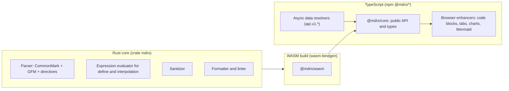

# Roadmap

MDRS currently lives inside this repository (`packages/lib`). The plan is to extract it into its own TypeScript + Rust project, publish it to npm and crates.io, and consume it here as a dependency, then grow tooling around the language.

## The name

- **MDRS** stands for **Markdown Rich Syntax**. It also reads as "md + rs" (Rust), the way MDX reads as "md + jsx", but the long form keeps its meaning even for a non-Rust implementation.
- File extension: **`.mdrs`** (not registered in GitHub Linguist as of 2026-10-17).
- Rejected: `mdsx`, because npm already has `mdsx` from svecosystem ("A Markdown processor for Svelte"), which would be confusing in a Svelte codebase. Every three-letter `md?` name on npm was taken except `mdq`, and that name is closely associated with "Markdown query" tools.

## Reserved names

Reserved on 2026-10-17:

| Where | Name | State |
| --- | --- | --- |
| GitHub | `farhnkrnapratma/mdrs` | Private repository holding the `0.0.0` placeholder |
| crates.io | [`mdrs`](https://crates.io/crates/mdrs) | `0.0.0`, exposes `FILE_EXTENSION` and `is_mdrs_path` |
| npm | org [`@mdrs`](https://www.npmjs.com/org/mdrs), package [`@mdrs/core`](https://www.npmjs.com/package/@mdrs/core) | `0.0.0`, exposes `FILE_EXTENSION` and `isMdrsPath` |

The unscoped npm name `mdrs` can't be used: npm rejects it as "too similar to existing packages md5, ms, mri, cors". Owning the `@mdrs` org covers every future package, such as `@mdrs/wasm`, `@mdrs/lsp`, `@mdrs/cli` and `@mdrs/prettier-plugin`.

Still free on crates.io on 2026-10-17, to claim when they're actually built: `mdrs-core`, `mdrs-cli`, `mdrs-lsp`, `mdrs-wasm`, `mdrs-fmt`, `tree-sitter-mdrs`.

## Planned architecture

- **Rust core.** Parsing, directives, the expression language, sanitizing (for example with the `ammonia` crate), formatting and linting. It compiles to WebAssembly with `wasm-bindgen`. Native Node addons (napi-rs) aren't an option, because Cloudflare Workers can't load them; this repository already ships WASM inside Workers.
- **Data resolvers stay in TypeScript.** The WASM core can't query the database. It collects the `api.v1.*` references it needs, the host resolves them asynchronously, and the core finishes rendering with the results. Hosts other than this site plug in their own resolvers.
- **Math.** KaTeX is a JavaScript library: either keep calling it from the TypeScript layer, or move to a Rust TeX renderer once one matches its output.
- **Size.** The WASM bundle has to fit the Workers script size limit (3 MB compressed on the free plan, 10 MB on paid plans).

## Compatibility work

The known gaps were closed on 2026-10-17 ([Compatibility](001-compatibility.md)): interpolation is opt-in through `:::define`, inline `$$` ignores prices, numbered lists keep task states, loose lists keep `
`, the HTML allowlist is wider, and GitHub alerts render. The next step is running the CommonMark and GFM spec examples as a test suite in the standalone package.

## Site-specific behaviour to make configurable

These parts are hard-coded for my-site.example today and become options in the package:

- The CDN image pattern that triggers AVIF + WebP `<picture>` output.
- The default stylesheet. The HTML already uses only stable `mdrs-*` classes ([Styling](003-styling.md)); the package will ship `mdrs.css` as plain CSS with custom properties instead of the Tailwind `@apply` rules used here.
- The `api.v1` resource registry (`author`, `blog`).
- Icon libraries (Lucide, Bootstrap Icons).
- The size and nesting limits.

## Language tooling

| Tool | Plan |
| --- | --- |
| Language server | `mdrs-lsp` on `tower-lsp`: diagnostics from the parser and define validation, completion for directive names, attributes, icon names and `${…}` variables, hover for variables, go to definition for variables and footnotes |
| Syntax highlighting | A `tree-sitter-mdrs` grammar, plus a TextMate grammar for VS Code and GitHub Linguist |
| Formatter | `mdrs fmt` in the core, exposed to Prettier through a plugin |
| Linter | `mdrs lint`: unclosed or unknown directives, missing required attributes, unused variables, broken footnote and heading links |
| Editors | A VS Code extension bundling the grammar and the language server |

Source: package metadata in `~/Projects/mdrs` (`Cargo.toml`, `package.json`).
