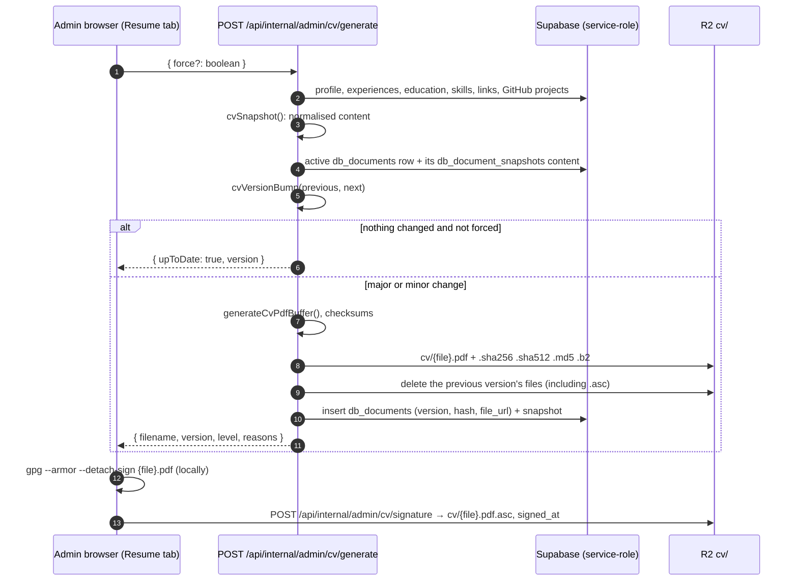

# 11. CV Documents

The admin generates the CV PDF on fkp-admin (`POST /api/internal/admin/cv/generate`). The server picks the version number itself, stores the PDF with its checksums in R2 under `cv/`, and the admin can attach a detached GPG signature.



## Versioning

File name: `CV-{Name}-{sha256[0..7]}-v{major}.{minor}.pdf`. The first CV is `v1.0`. There is no patch number. Older names such as `-v1.0.13.pdf` are read as `1.0`.

The bump is decided by `cvVersionBump()` (`packages/lib/src/cvVersion.ts`), which compares the new content snapshot with the snapshot of the active version.

**Major** (`v1.3` → `v2.0`): who you are or what you have done.

| Change | Example |
| --- | --- |
| Name or job title | `Software Engineer` → `Senior Software Engineer` |
| Work experience added or removed | a new job |
| Company, role, employment type or dates of an experience | the "currently here" job ends |
| Education added or removed, or its institution, degree, field or dates | a master's degree is added |

**Minor** (`v1.3` → `v1.4`): refinements.

| Change | Example |
| --- | --- |
| Descriptions of experience or education, bio, grade | rewording a bullet point |
| Skills | adding Go, reordering categories |
| Projects | a GitHub repository is pinned, excluded, or its stars change the order |
| Contact details and links | email, website, location, GitHub or LinkedIn |
| Profile photo | a new avatar |
| PDF template | `CV_TEMPLATE_VERSION` is raised |

- When both kinds of change are present, the bump is major. The response lists every reason, e.g. `Experience added, Bio changed`.
- When nothing changed, no new file is made and the admin shows "The CV is already up to date". **Regenerate** forces a new build, which counts as minor (useful after a font change).
- A CV without a stored snapshot (made before this scheme) gets a minor bump on its next generation.
- Saving the profile or the resume entries in the admin calls generate without `force`, so unchanged content never creates a version.

## Files in `cv/`

| File | Content |
| --- | --- |
| `{file}.pdf` | the CV |
| `{file}.pdf.sha256`, `.sha512`, `.md5`, `.b2` | coreutils format: `{hex}  {file}.pdf` (BLAKE2b-512 for `.b2`) |
| `{file}.pdf.asc` | optional ASCII-armored detached GPG signature |

Verify a download:

```sh
sha256sum -c CV-Name-1234567-v1.0.pdf.sha256
b2sum -c CV-Name-1234567-v1.0.pdf.b2
gpg --verify CV-Name-1234567-v1.0.pdf.asc CV-Name-1234567-v1.0.pdf
```

## Signature

- The private key never reaches the server. Sign the exact PDF locally with `gpg --armor --detach-sign {file}.pdf` and upload the `.asc` at the bottom of the CV Document card.
- `POST /api/internal/admin/cv/signature` accepts only an ASCII-armored `PGP SIGNATURE` block of at most 16 KiB (`isArmoredSignature()`). `DELETE` removes it. Both are admin-only and same-origin.
- A new CV version deletes the old signature, because a signature covers one file. The card shows "Not signed yet" until the new PDF is signed.

## Data

- `db_documents` (public read): `filename`, `file_url`, `hash` (SHA-256), `version`, `signed_at`, `is_active`.
- `db_document_snapshots` (service role only): the content snapshot per document. It holds contact details, so it is not on the public table.

## Source

- `packages/lib/src/server/adminCv.ts` (`processCvGenerate`, `processCvSignature`, `deleteCvFile`)
- `packages/lib/src/cvVersion.ts`, `packages/lib/src/server/cvChecksums.ts`
- `apps/admin/src/routes/api/internal/admin/cv/{generate,signature,delete}/+server.ts`
- `apps/admin/src/routes/(admin)/+page.svelte` (CV Document card)
- `supabase/migrations/20261016120000_cv_versions.sql`
