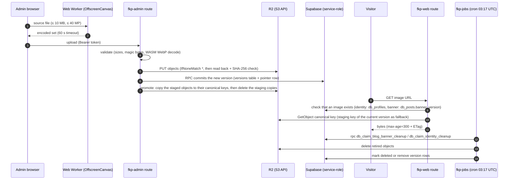

# 8. Image Pipeline: Encode, Validate, Store, Serve, Clean Up

Images are encoded **in the browser**, validated again on the server, written to R2 through the S3 API, served by fkp-web routes, and cleaned up by fkp-jobs. Markdown bodies are stored separately in Supabase Storage.

## Asset types

| Asset | Encoder (packages/lib/src) | Server check | R2 key | Served at |
| --- | --- | --- | --- | --- |
| Avatar + icons | `processAvatar.ts` → `workers/avatar.worker.ts`: PNG icon set, `favicon.ico`, SVG, `avatar.webp`, `avatar.avif` (both required) | `validateAvatar.ts`: PNG structure/CRC, ICO directory, WebP/AVIF magic bytes (AVIF checks `ftyp` brand), SVG rebuilt | `identity/{name}`, next to the website banner | `/{name}` and `/hero.png`, handled in the web and admin hooks by `serveIdentityAsset()` |
| Blog banner | `processBanner.ts` → `workers/banner.worker.ts`: WebP + AVIF 1280×640, ≤ 500 KiB | `validateBanner.ts` (WebP WASM decode) | `blog/banners/{postUuid}.{webp,avif}` | `/blog/banners/{public_id}.{webp,avif}` (admin: `{postUuid}`) → `serveBlogBanner()` |
| Markdown image | `processContentImage.ts` → `workers/contentImage.worker.ts`: WebP + optional AVIF, max edge 2400, ≤ 500 KiB | `validateContentImage.ts`: `inspectWebp` + WebP decode; the AVIF file goes through `validateContentImageAvif` (`inspectAvif` box parse, ≤ 500 KiB, same dimensions as the WebP) | `blog/content/{sha256}.{ext}` | `/blog/content/{sha256}.{ext}` → `getContentAsset()` |
| Markdown video | uploaded as-is, content type sniffed | `admin/blog/content-video` route | `blog/content/{sha256}.{mp4,webm}` | `/blog/content/{file}` |
| Website banner | `processSiteBanner.ts` → `workers/siteBanner.worker.ts`: `banner.avif`, `banner.webp` (1280×640), `banner-og.webp` (1200×630) | `validateSiteBanner.ts`: `inspectAvif` / `inspectWebp` with exact dimensions | `identity/{name}`, next to the avatar | `/banner.{avif,webp}`, `/banner-og.webp` → `serveIdentityAsset()` |
| CV PDF | generated server-side (`pdfGenerator.ts`) | – | `{filename}` at the bucket root (for example `…-v1.2.3.pdf`), plus a `{filename}.sha256` sidecar | `db_documents.file_url` (CDN URL), streamed by `/v1/cv?output=pdf` |
| Post Markdown | – | – | Supabase Storage `blog-posts`, `posts/{postUuid}/{operationId}.md` | read by page loads and the API |

## Serving rules

- **One image per owner, no versions in URLs.** The site keeps one profile image, one website banner and one banner per post, each in several formats. Public URLs never carry a version, and any identity request with `?v` returns 404. Old `/blog/banners/{id}/{version}.{ext}` paths return 404.
- **Staging and promotion.** Saves still upload to a staging key per version (`identity/{version}/{name}`, `blog/banners/{postUuid}/{operationId}.{ext}`) so a failed or conflicting save never touches the live image. After the DB commit the admin route copies the staged files to the canonical key (`promoteIdentity()`, `promoteBanner()`) and deletes the staging copies. A partial identity save first copies the unchanged group from the canonical keys into the new staging folder (`copyAssets()`).
- **Fallback.** If promotion failed, serving falls back to the staging key of the current version (`readIdentityObject()`, `getBannerObject()`), which is only deleted after a successful copy.
- **Identity assets** (`serveIdentityAsset`, `packages/lib/src/server/profileAssets.ts`): 13 files (`identityAssetNames` in `siteIdentity.ts`). `db_profiles.avatar_version` and `banner_version` only say that an image exists. When no version exists yet: fallback to `PUBLIC_CDN_BASE_URL/{name}`.
- **Blog banners** (`serveBlogBanner`, service-role): served when `db_posts.banner_version` is set. Errors are `no-store`.
- **Cache:** images are `public, max-age=300` (`IMAGE_CACHE_CONTROL`) with the R2 ETag, so a change shows within about 5 minutes and revalidations return 304. The admin editors show the locally prepared image right after a save.
- **Content assets** are content-addressed (SHA-256), so they are always `immutable`.

## Cleanup

- **`cleanupBlogAssets`** (`blogBannerStorage.ts`):
    - Banners: claims retired banner versions, deletes the `.webp` and `.avif` objects, and sets `state='deleted'`. On failure it records `cleanup_error`.
    - Markdown: removes orphaned files listed in `db_post_storage_cleanup` that are more than 24 h old and no longer referenced by `db_posts.storage_path`.
- **`cleanupAssets`** (`profileAssets.ts`): claims retired identity versions, deletes any leftover staging objects in `identity/{id}/`, then deletes the version row. `data/delete-all` also removes the canonical identity files and post banners.
- **Callers:** the jobs cron, admin `posts` / `posts/cleanup`, `profile` / `profile/cleanup`, and `data/delete-all`.

## Source

- `packages/lib/src/process*.ts`, `packages/lib/src/workers/*.worker.ts`
- `packages/lib/src/server/validate*.ts`, `profileAssets.ts`, `blogBannerStorage.ts`, `blogBannerResponse.ts`, `blogContentStorage.ts`
- `packages/lib/src/blogBanner.ts`, `blogContentImage.ts`, `siteIdentity.ts`
- `apps/web/src/routes/blog/banners/[file]/+server.ts`, `blog/content/[file]/+server.ts`
- `apps/admin/src/routes/api/internal/admin/{profile,blog/content-image,blog/content-video}/+server.ts`
