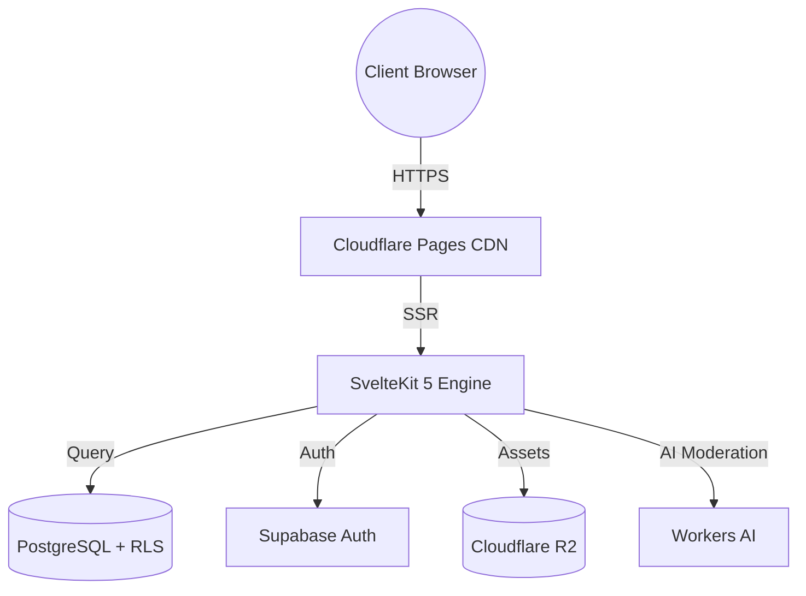
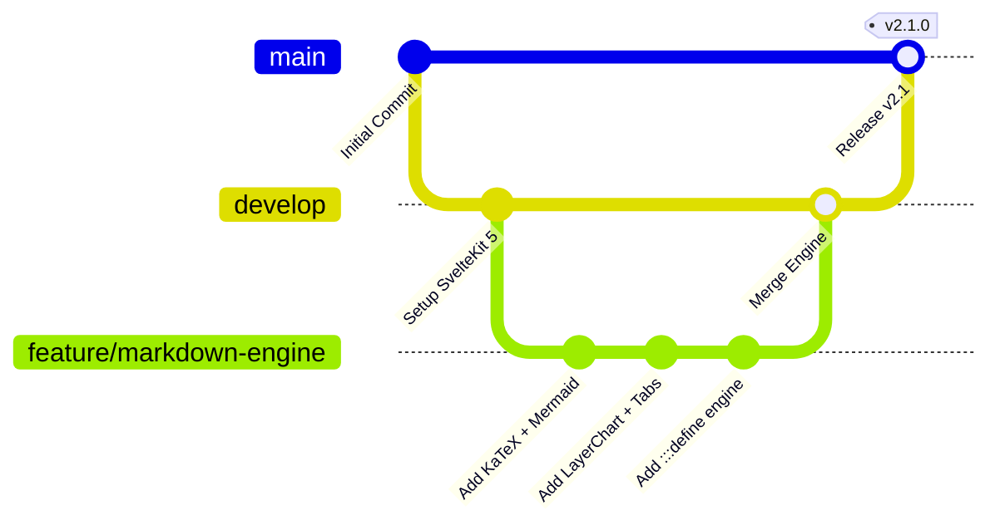

:::define
site_name: "my-site.example"
engine_version: "2.1"
current_year: 2026
is_production: true
visitor_greeting: "Welcome to " + this.site_name + ", where markdown comes alive"
math_demo: (2 + 3) * 4
supported_locales: ["en", "id"]
engine_stats: { directives: 14, chart_types: 5, since: 2026, stable: true }
:::

:::note
**${visitor_greeting}.** This is not your average markdown renderer. What you are reading right now is a living document: every heading, chart, formula, and data point on this page is processed by our custom-built **Next-Gen Markdown Engine**, compiled at the edge, and delivered in under 100ms. Below is everything it can do.
:::

---

## Typography That Speaks

Formatting is the foundation. We support every inline style you would expect, and a few you would not.

- **Bold** with `**asterisks**` or `__underscores__`
- _Italic_ with `_underscores_` or `*asterisks*`
- _**Bold italic**_ for when you really mean it
- ~~Strikethrough~~ for deprecated ideas
- <u>Underline</u> for emphasis that stands apart
- `Inline code` like `const x: number = 42` rendered in monospace
- <mark>Highlighted text</mark> for search-match style callouts
- Chemical formulas: H<sub>2</sub>O, and exponents: 10<sup>6</sup>
- Keyboard shortcuts: <kbd>Ctrl</kbd> + <kbd>Shift</kbd> + <kbd>P</kbd> opens the Command Palette

Every heading level renders with its own typographic scale:

# Heading 1
## Heading 2
### Heading 3
#### Heading 4
##### Heading 5
###### Heading 6

---

## Links, Quotes and Breaks

Links follow the standard `[text](url "title")` form. The optional title becomes a tooltip: [Google](https://google.com "Google").

> A greater than sign opens a blockquote.

A backslash at the end of a line\
forces a line break.

Three asterisks or three dashes draw a thematic break:

***

---

## Lists & Task Tracking

### Ordered Lists

1. Provision your edge runtime and database
2. Configure server-side rendering:
   1. Set up KaTeX compilation
   2. Wire Mermaid lazy hydration
3. Ship it

### Unordered Lists

- **Frontend**: SvelteKit 5 with Svelte Runes, Tailwind CSS 4, Cloudflare Pages
- **Backend**: Supabase PostgreSQL with Row Level Security, Cloudflare R2 Storage
- **Engine**: Custom directive parser, KaTeX SSR, LayerChart, Mermaid.js

### Task Lists with Seven Status States

Every checkbox state gets its own icon and color, not just checked and unchecked:

- [x] Ship KaTeX server-side math rendering
- [*] Interactive chart tooltips with accessibility labels (WIP)
- [/] Legacy graph parser removal (Cancelled)
- [-] Plugin migration to v3 hooks (On-Hold)
- [!] Critical: patch CVE-2026-XXXX in dependency tree (Alert)
- [?] Should code tabs persist selection via `localStorage`? (Review)
- [ ] Footnote back-reference animations (Planned)
  - [x] Sub-task: multi-backref letter indexing
  - [*] Sub-task: smooth scroll behavior
  - [ ] Sub-task: accessibility audit

---

## Callouts

### Alerts

Five built-in severity levels, each written as `:::type` and closed with `:::`. The content is regular Markdown:

````markdown filename="alerts.md"
:::note
Background context.
:::
````

:::note
Background context or supplementary information: things the reader should know but can safely skip.
:::

:::tip
Performance tricks, shortcuts, or best practices that save time.
:::

:::important
Prerequisites, critical configuration, or steps that must not be skipped.
:::

:::warning
Deprecations, breaking changes, or behaviors that might surprise you.
:::

:::caution
Actions that risk data loss, security exposure, or irreversible damage.
:::

### Custom Callouts

Beyond the five fixed types, `:::callout` takes a required `title` and an optional `icon`. Icons resolve to Lucide first and fall back to Bootstrap Icons. Use `lucide-` or `bi-` to pick a library explicitly:

````markdown filename="callout.md"
:::callout title="Changelog" icon="list"
Content with **Markdown**.
:::
````

:::callout title="Changelog" icon="list"
**v${engine_version}.0**: Added `:::define` variable interpolation with live `api.v1.*` data binding, rich media embeds, and custom callouts.
:::

:::callout title="Pro Tip" icon="zap"
Combine `:::define` variables with `[conditional text].${boolean}` syntax to show or hide entire paragraphs based on runtime state, no JavaScript required.
:::

:::callout title="Forced Lucide icon" icon="lucide-rocket"
`icon="lucide-rocket"` always uses the Lucide library.
:::

:::callout title="Forced Bootstrap icon" icon="bi-facebook"
`icon="bi-facebook"` always uses Bootstrap Icons.
:::

:::callout title="No icon"
The `icon` attribute is optional.
:::

---

## Code Blocks

### Filename and Line Markers

Add `filename="..."` after the language to show a file name next to it. The downloaded file gets the same name. Add `mark=...` to spotlight lines; ranges use `..`. Both are optional. Here, lines 2 and 5 to 7 are highlighted:

````markdown filename="example.md"
```typescript filename="auth.svelte.ts" mark=2,5..7
```
````

```typescript filename="auth.svelte.ts" mark=2,5..7
import {writable, derived} from 'svelte/store'
import type {UserProfile, AuthSession} from '$lib/types'

export function createAuthStore(initialSession: AuthSession | null) {
  let session = $state<AuthSession | null>(initialSession)
  let isAuthenticated = $derived(session !== null)
  let userEmail = $derived(session?.user?.email ?? '')

  function login(newSession: AuthSession) {
    session = newSession
  }

  function logout() {
    session = null
  }

  return {
    get session() { return session },
    get isAuthenticated() { return isAuthenticated },
    get userEmail() { return userEmail },
    login,
    logout
  }
}
```

Without a filename the language name is shown alone and the download falls back to a generic name:

```python mark=1
print("Hello, World!")
```

```python filename="main.py"
print("Hello, World!")
```

### Diff Highlighting

Lines starting with `+` are additions, `-` are removals, with full-width colored backgrounds, just like a pull request:

```diff filename="example.diff"
--- a/src/lib/example.ts
+++ b/src/lib/example.ts
@@ -1,5 +1,8 @@
 import {isAiBindingAvailable} from '$lib/server/ai'
-const MAX_ATTEMPTS = 2
+const MAX_ATTEMPTS = 3
+
+function withinTolerance(a: number, b: number, tolerance: number): boolean {
+  return Math.abs(a - b) <= tolerance
+}
```

---

## Mathematical Formulas

KaTeX compiles entirely server-side, with zero client JavaScript for math rendering.

### Inline

Wrap a formula in double dollar signs on a single line: `$$ formula $$`. Euler's identity $$ e^{i\pi} + 1 = 0 $$ is often called the most beautiful equation in mathematics. The Pythagorean theorem $$ a^2 + b^2 = c^2 $$ and the quadratic formula $$ x = \frac{-b \pm \sqrt{b^2 - 4ac}}{2a} $$ render seamlessly inline. A single dollar sign stays plain text, so prices like $5 and $10 are safe.

### Block Display

Use a `:::math` block for display equations. The Gaussian integral, one of the most important results in probability theory:

:::math
\int_{-\infty}^{\infty} e^{-x^2} \, dx = \sqrt{\pi}
:::

The Basel problem, solved by Euler in 1734:

:::math
\sum_{n=1}^{\infty} \frac{1}{n^2} = \frac{\pi^2}{6}
:::

---

## Architecture Diagrams

Mermaid.js renders lazily in the browser. The engine injects a loading placeholder at SSR time and hydrates the SVG on scroll.

### System Architecture



### Git Branching Strategy



---

## Interactive Data Visualizations

Six chart types powered by LayerChart and D3, declared in YAML and rendered as interactive Svelte components with tooltips and hover states.

### Line Chart

```chart
type: line
title: Monthly Active Developers
subtitle: 2026 Growth Trajectory
x: month
y: users
data:
  - { month: "Jan", users: 1200 }
  - { month: "Feb", users: 1950 }
  - { month: "Mar", users: 3100 }
  - { month: "Apr", users: 4400 }
  - { month: "May", users: 6200 }
  - { month: "Jun", users: 8900 }
```

### Multi-Series Line Chart

The `series` property enables overlaying multiple datasets with custom labels and colors:

```chart
type: line
title: Build Performance Over Time
subtitle: Cold-start compilation speed (ms, lower is better)
x: version
y: ["svelte", "react", "vue"]
series:
  - { key: "svelte", label: "SvelteKit", color: "#ff3e00" }
  - { key: "react", label: "Next.js", color: "#61dafb" }
  - { key: "vue", label: "Nuxt", color: "#42b883" }
data:
  - { version: "v1.0", svelte: 450, react: 1200, vue: 900 }
  - { version: "v1.5", svelte: 380, react: 950, vue: 780 }
  - { version: "v2.0", svelte: 310, react: 820, vue: 650 }
  - { version: "v2.5", svelte: 260, react: 740, vue: 580 }
  - { version: "v3.0", svelte: 190, react: 680, vue: 520 }
```

### Bar Chart

```chart
type: bar
title: Lighthouse Performance Score
subtitle: Modern framework benchmark (out of 100)
x: framework
y: score
data:
  - { framework: "SvelteKit 5", score: 99 }
  - { framework: "Astro 5", score: 98 }
  - { framework: "VitePress", score: 96 }
  - { framework: "Nuxt 3", score: 91 }
  - { framework: "Next.js 15", score: 88 }
```

### Area Chart

```chart
type: area
title: p95 Response Time
subtitle: Rolling 7-day edge latency (ms)
x: day
y: latency
data:
  - { day: "Mon", latency: 120 }
  - { day: "Tue", latency: 98 }
  - { day: "Wed", latency: 145 }
  - { day: "Thu", latency: 110 }
  - { day: "Fri", latency: 132 }
  - { day: "Sat", latency: 87 }
  - { day: "Sun", latency: 92 }
```

### Donut Chart

```chart
type: donut
title: Traffic Distribution
subtitle: Visitor breakdown by channel
x: channel
y: visitors
data:
  - { channel: "Organic Search", visitors: 4500 }
  - { channel: "GitHub Referrals", visitors: 3200 }
  - { channel: "Direct / RSS", visitors: 1800 }
  - { channel: "Social Media", visitors: 950 }
```

### Pie Chart

```chart
type: pie
title: Repository Language Breakdown
subtitle: By lines of code
x: language
y: percentage
data:
  - { language: "TypeScript", percentage: 62 }
  - { language: "Svelte", percentage: 24 }
  - { language: "SQL", percentage: 9 }
  - { language: "CSS", percentage: 5 }
```

---

## Content Tabs

### General Content Tabs (`:::tabs`)

`:::tabs` presents alternative content blocks. Each `::tab` takes a required `label` and an optional `icon` (Lucide or Bootstrap Icons, same rules as callouts), and is closed with `::`. Here, a comparison of rendering strategies:

:::tabs
::tab label="Server-Side Rendering (SSR)" icon="server"
SSR generates the full HTML on the server before sending it to the browser. The page is immediately readable: search engines index real content, and users on slow connections see meaningful output without waiting for JavaScript to boot.

#### When to use SSR

:::steps
1. Content-heavy pages where SEO matters (blogs, documentation, landing pages).
2. Users on low-powered devices or constrained networks.
3. Pages where time-to-first-byte is more important than interactivity latency.
:::
::
::tab label="Client-Side Rendering (CSR)" icon="monitor"
CSR ships a minimal HTML shell and builds the page entirely in the browser via JavaScript. The initial load is faster in bytes, but the page is blank until the framework hydrates, making it unsuitable for content that needs to be indexed or immediately visible.

#### When to use CSR

:::steps
1. Highly interactive dashboards or real-time applications.
2. Authenticated pages behind a login wall (no SEO needed).
3. Single-page apps where subsequent navigation speed matters more than first paint.
:::
::
:::

### Code Snippets (`:::snippets`)

`:::snippets` is the code-oriented variant: it adds copy and download controls for the active tab. The optional `key` synchronizes every snippet group that shares it. Pick your package manager once, and every code block updates:

:::snippets key="bundler"
::tab label="bun" icon="terminal"
```bash
bun add layerchart katex mermaid
```
::
::tab label="npm" icon="package"
```bash
npm install layerchart katex mermaid
```
::
::tab label="pnpm" icon="package"
```bash
pnpm add layerchart katex mermaid
```
::
::tab label="yarn" icon="package"
```bash
yarn add layerchart katex mermaid
```
::
:::

Select a tab above, then notice the selection carries over here:

:::snippets key="bundler"
::tab label="bun"
```bash
bun run dev
```
::
::tab label="npm"
```bash
npm run dev
```
::
::tab label="pnpm"
```bash
pnpm dev
```
::
::tab label="yarn"
```bash
yarn dev
```
::
:::

---

## Step-by-Step Timelines

The `:::steps` directive transforms lists and headings into a numbered timeline with connecting lines.

### Heading-Based

:::steps

### Install Dependencies

```bash
bun add katex mermaid layerchart d3-scale d3-shape
```

### Configure Server-Side Compilation

Wire KaTeX and the directive preprocessor into `src/lib/markdown.ts`. Math formulas compile to HTML+MathML at build time, zero client JS.

### Hydrate Client Enhancements

Attach `enhanceMarkdownContent()` in your page effect to lazily activate Mermaid, LayerChart, and Code Tabs on scroll.

### Verify and Ship

```bash
bun run check && bun run lint
```

:::

### Ordered List-Based

:::steps
1. Clone the repository and create your `.env` from the example template.
2. Run `bun install` to install all workspace dependencies.
3. Start the dev server with `bun run dev`, hot module replacement included.
4. Verify with `bun run check` and `bun run lint` before pushing.
:::

### Unordered List-Based

:::steps
- Provision edge functions and R2 storage buckets.
- Run the integration smoke test suite.
- Promote the preview deployment to production.
:::

---

## Dynamic Variables

Every value on this page is alive. The `:::define` block at the top of this document declares typed variables (strings, numbers, booleans, arrays, and objects) with full expression support: arithmetic (`+ - * / %`), comparison (`== != > < >= <=`), logical (`&& || !`), and cross-references via `this.*`.

### What was declared

```text
:::define
site_name: "my-site.example"
engine_version: "2.1"
current_year: 2026
is_production: true
visitor_greeting: "Welcome to " + this.site_name + ", where markdown comes alive"
math_demo: (2 + 3) * 4
supported_locales: ["en", "id"]
engine_stats: { directives: 14, chart_types: 5, since: 2026, stable: true }
:::
```

### What you see (live interpolation)

- Greeting: **${visitor_greeting}**
- Site: **${site_name}**, engine v${engine_version}, copyright ${current_year}
- Expression `(2 + 3) * 4` evaluates to: **${math_demo}**
- First locale: **${supported_locales[0]}** out of ${supported_locales.length} supported
- Directive count from nested object: **${engine_stats.directives}**
- [You are viewing the production build of this page.].${is_production}
- [You are viewing a development build.].${!is_production}

---

## Live Data Binding

The `api.v1.*` prefix fetches real data from this site's own API at render time, with no manual `curl` and no hardcoded values. The engine resolves paths like `api.v1.author.profile.name` against the live Supabase database during server-side rendering.

- Author: **${api.v1.author.profile.name}**
- Published posts: **${api.v1.blog.length}**

This is the same data you would get from `GET /api/v1/author?fields=profile` and `GET /api/v1/blog`, but inlined directly into the markdown body at compile time. No client-side fetch, no loading spinner, no layout shift.

---

## Images and Videos

Images and videos share one syntax: ``. The source extension decides the element: `.mp4` and `.webm` render a `<video>` with controls, anything else renders an ``. The alt text is the accessible label and the optional title is the tooltip.

````markdown filename="media.md"


````

Upload media from the editor toolbar: it inserts the correct syntax for you.

---

## Media Embeds

A single `:::embed url="..."` line handles provider detection, responsive aspect-ratio wrapping, and iframe security. No manual HTML needed, and no closing line:

:::embed url="https://youtu.be/Ec08db2hP10?si=eLTsf5ioVK5OwQOi"

:::embed url="https://youtu.be/VyPwEZTIpVc"

Unrecognized providers fall back to a styled external link instead of a broken iframe:

:::embed url="https://example.com/some-video"

---

## Feature Matrix

| Feature | Engine | Rendering | Output |
| :--- | :---: | :---: | :--- |
| **LaTeX Math** | KaTeX | Server SSR | HTML + MathML |
| **Diagrams** | Mermaid.js | Lazy Client | SVG |
| **Charts** | LayerChart + D3 | Svelte 5 Mount | Interactive SVG |
| **Content Tabs** | Directive Parser | Client Enhanced | ARIA Tabpanels |
| **Code Snippets** | Directive Parser | Client Enhanced | Synced Tabpanels |
| **Callouts** | Directive Parser | Server HTML | Alerts and Custom Cards |
| **Timelines** | CSS Counters | Server HTML | Numbered Cards |
| **Variables** | Expression Engine | Server SSR | Interpolated Text |
| **Data Binding** | `api.v1.*` Resolver | Server SSR | Live Data |

---

## Collapsible Sections

Use `:::details` with a required `summary`. The content is regular Markdown, and details can be nested:

:::details summary="What does server-side rendered math actually mean?"
KaTeX compiles LaTeX expressions into HTML and MathML markup during the SSR pass on the server. The browser receives fully-formed math output: no JavaScript bundle, no render flash, no layout shift. This is why formulas on this page appear instantly even with JavaScript disabled.
:::

:::details summary="How are Mermaid diagrams loaded without blocking the page?"
The markdown compiler replaces each mermaid fence with a lightweight placeholder div. A client-side observer watches for viewport intersection, then dynamically imports the Mermaid library and renders the SVG in place. The diagram never blocks initial page load.

:::details summary="Nested example"
Details can contain any other block, including code and lists:

- A list item
- Another list item

```bash filename="nested.sh"
echo "inside a nested details block"
```
:::
:::

---

## Footnotes

The engine compiles `[^label]` markers into superscript links with numbered back-references[^1]. KaTeX math runs entirely at build time[^math], and the `api.v1.*` resolver demonstrated above fetches data from the same Supabase instance that powers the REST API[^api].

:::references
[^1]: Directives like `:::define`, `:::tabs`, and `:::callout` are parsed in a pre-processing pass over raw markdown before `marked.parse()` runs.
[^math]: KaTeX renders **server-side during SSR**, so no client JavaScript is required to display formulas. Mermaid diagrams, by contrast, hydrate lazily in the browser.
[^api]: The `api.v1.*` resolver calls the same Supabase queries as `GET /api/v1/author` and `GET /api/v1/blog`, but at compile time rather than via HTTP.
:::
